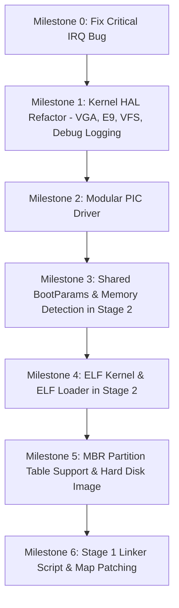

# myOS vs nanobyte_os: Architecture Comparison & Implementation Tracker

**Document Version:** 1.0  
**Created:** September 10, 2026  
**Last Updated:** September 10, 2026  
**Status:** In Progress — Tracking parity milestones with `nanobyte_os`

---

## 1. Executive Summary & Status Dashboard

| Component | myOS Current State | nanobyte_os Reference State | Parity Status | Next Step |
| :--- | :--- | :--- | :---: | :--- |
| **Stage 1 Bootloader** | Linked with `linker.ld`, dynamic `stage2_location` patching, preserves BPB, forwards MBR partition | Linked with `linker.ld`, symbol map patching, preserves BPB, forwards MBR partition | 🟢 Parity Achieved | Complete |
| **Stage 2 Bootloader** | Has MBR partition detection (`mbr.c`), E820 memory detection, BootParams, FAT12/16/32 with 5-sector cache, ELF32 loader | ELF32 parser (`/boot/kernel.elf`), MBR partition detection, E820 memory detection, FAT12/16/32 + cache + LFN | 🟢 Parity Achieved | Complete |
| **Kernel Binary & Entry** | ELF32 executable at 1MB, `start(BootParams*)`, calls `_init()` global ctors | ELF32 executable at 1MB, `start(BootParams*)`, calls `_init()` global ctors | 🟢 Parity Achieved | Complete |
| **Physical Memory Manager** | Bitmap frame allocator in HAL (`pmm.c`), 32-bit fast bit-scan, contiguous multi-page allocation | Basic memory primitives only (`memcpy`, `memset`, `memcmp`) | 🟢 Surpassed nanobyte_os | Complete |
| **Virtual Memory Manager** | Two-level x86 paging (`vmm.c`, `vmm_asm.asm`), recursive self-mapping, identity mapping, `#PF` handler | None | 🟢 Surpassed nanobyte_os | Complete |
| **Kernel Heap Allocator** | Boundary-tag dynamic allocator (`heap.c`), 8-byte alignment, block splitting, $O(1)$ coalescing, dynamic expansion (`kmalloc`, `kzalloc`, `kfree`, `krealloc`) | None | 🟢 Surpassed nanobyte_os | Ready for Tasking / Scheduler |
| **Kernel Interrupts & PIC** | Modular `PICDriver` interface (`i8259.c`), auto-unmasking, ISR bound | Modular `PICDriver` interface, `i8259` driver with probe, proper ISR routing | 🟢 Parity Achieved | Ready for APIC in future |
| **HAL & Drivers** | Clean `vga_text.c`, port 0xE9 (`e9.c`), `vfs.c` router, structured `debug.c`, `pmm.c`, `vmm.c`, `heap.c` | Separated `vga_text.c`, port 0xE9 debug (`e9.c`), minimal `vfs.c`, structured logger (`debug.c`) | 🟢 Parity Achieved | Complete |
| **Shared Libs (`libs/`)** | `src/libs/boot/bootparams.h` shared across Stage 2 & Kernel | `src/libs/boot/bootparams.h`, `src/libs/core/` (C++ device abstractions) | 🟡 BootParams Parity | Add C++ core library (optional) |
| **Build & Tooling** | CMake + Makefile; dynamic bootloader patching via `install_bootloader.py` | SCons; disk image tool supports Floppy & MBR Hard Drive with dynamic patching | 🟢 Parity Achieved | Complete |

---

## 2. Component-by-Component Detailed Comparison

### Component 1: Bootloader Stage 1 (`src/bootloader/stage1/`)

#### Comparison Matrix
| Feature | `nanobyte_os` | `myOS` | Impact / Assessment |
| :--- | :--- | :--- | :--- |
| **Build Mechanism** | `nasm -f elf` + `i686-elf-ld -T linker.ld` | `nasm -f bin boot.asm -o boot.bin` | `nanobyte_os` produces symbol map (`stage1.map`) with exact offsets of symbols (`stage2_location`, `__entry_start`). |
| **Filesystem Header (BPB)** | Preserved during installation; skips BPB bytes so `mkfs.fat` BPB is intact | Overwritten completely by `dd` with `boot.bin`; requires hardcoded BPB to match filesystem params | Overwriting BPB risks breaking on non-standard geometry or when switching filesystem formats. |
| **Stage 2 Location** | Patched dynamically by image builder into `stage2_location` (LBA + sector count) | Hardcoded in assembly: reads 32 sectors starting from LBA 1 | In `myOS`, if `stage2.bin` grows > 16 KB (32 sectors), bootloader fails or truncates. |
| **MBR Partition Forwarding** | Reads `DS:SI` from MBR, saves to `0x2000:0x0000`, passes to Stage 2 in `DI:SI` | Discards `DS:SI`; only saves `DL` (drive ID) | `myOS` cannot support bootable MBR partitions on hard drives. |
| **Disk Read Modes** | LBA extensions (`int 13h ah=42h`) + CHS fallback (`ah=02h`) with disk reset on error | LBA extensions + CHS fallback with retry | Both support LBA and CHS. `nanobyte_os` includes disk controller reset (`ah=00h`). |

#### Actionable Improvements for Stage 1:
- [x] **1.1:** Add `linker.ld` for Stage 1 to produce an ELF object and map file.
- [x] **1.2:** Store `DS:SI` partition entry at `0x2000:0000` and pass partition pointer to Stage 2.
- [x] **1.3:** Replace hardcoded 32-sector read with dynamic `stage2_location` populated by the build system.
- [x] **1.4:** Update disk image generation to patch boot sector without overwriting the formatted BPB.

---

### Component 2: Bootloader Stage 2 (`src/bootloader/stage2/`)

#### Comparison Matrix
| Feature | `nanobyte_os` | `myOS` | Impact / Assessment |
| :--- | :--- | :--- | :--- |
| **Entry Arguments** | `start(uint16_t bootDrive, void* partition)` | `start(uint16_t bootDrive, void* partition)` | Both receive partition entry pointer. |
| **Partition Layer** | `mbr.c` / `mbr.h` (`Partition` struct) | `mbr.c` / `mbr.h` (`Partition` struct) | Both abstract disk offset so floppy and hard disk partitions work identically. |
| **FAT Capabilities** | FAT12, FAT16, FAT32 support, 5-sector cache, Long File Name (LFN) decoding | FAT12, FAT16, FAT32 support, 5-sector cache | Parity achieved for filesystem reading and caching. |
| **Memory Detection** | E820 BIOS call (`x86_E820GetNextBlock`) builds `MemoryInfo` array | E820 BIOS call builds `MemoryInfo` array | Complete memory detection parity. |
| **Kernel Binary Format** | ELF32 (`elf.c`, `elf.h`) loading `/boot/kernel.elf` | ELF32 (`elf.c`, `elf.h`) loading `/boot/kernel.elf` | Both inspect `PT_LOAD`, auto-clear BSS, and jump to ELF entry. |
| **Boot Parameters** | Constructs `BootParams` (boot device, memory regions) and passes to kernel | Constructs `BootParams` and passes to kernel | Full parity. |
| **CRT Support** | `crti.asm`, `crtn.asm`, calls `_init()` | `crti.asm`, `crtn.asm`, calls `_init()` | Parity achieved. |
| **Standard Utilities** | Has `stdlib.c` (`qsort`) | None | Useful for sorting memory regions and directory entries. |

#### Actionable Improvements for Stage 2:
- [x] **2.1:** Implement MBR partition abstraction (`mbr.c` / `mbr.h`).
- [x] **2.2:** Add E820 BIOS memory map detection (`x86_E820GetNextBlock`, `memdetect.c`, `memdetect.h`).
- [x] **2.3:** Implement ELF32 loader (`elf.c`, `elf.h`) to parse `/boot/kernel.elf`.
- [x] **2.4:** Pass `BootParams*` struct containing boot device and memory regions to kernel.
- [x] **2.5:** Upgrade FAT driver to support FAT16/FAT32 and sector caching.
- [x] **2.6:** Fix enum typo in `fat.h` (`FAT_ATTRIVURE_*` -> `FAT_ATTRIBUTE_*`).

---

### Component 3: Kernel Architecture & Subsystems (`src/kernel/`)

#### Comparison Matrix
| Feature | `nanobyte_os` | `myOS` | Impact / Assessment |
| :--- | :--- | :--- | :--- |
| **Executable Format** | `elf32-i386` (`kernel.elf`) | Flat binary (`kernel.bin`) | Standard format allows inspection with `readelf`, `objdump`, and GDB debugging with symbols. |
| **Entry Signature** | `void start(BootParams* bootParams)` | `void start(uint16_t bootDrive)` | Receives system memory map and hardware metadata. |
| **Global Constructors** | Calls `_init()` via `crti.asm` / `crtn.asm` | None | Enables C++ runtime and static constructors. |
| **Interrupt Registration** | `i686_ISR_RegisterHandler(PIC_REMAP_OFFSET + i, i686_IRQ_Handler)` | **BUG:** `i686_IRQ_RegisterHandler(PIC_REMAP_OFFSET + i, ...)` | **CRITICAL:** `myOS` writes 32 elements out-of-bounds in `g_IRQHandlers` and never binds IRQs to ISRs. |
| **PIC Architecture** | Abstract `PICDriver` (`i8259.c` implements driver interface) | Monolithic `pic.c` / `pic.h` | Modular design allows adding APIC without rewriting IRQ logic. |
| **VGA Display** | Dedicated `arch/i686/vga_text.c` & `vga_text.h` | Entangled in `stdio.c` | Decouples video hardware from formatted text streams. |
| **Debug Console** | Hardware port 0xE9 emulator driver (`e9.c`, `e9.h`) | None | Allows printing kernel logs directly to terminal in QEMU / Bochs. |
| **VFS Layer** | Minimal `vfs.c` (STDIN, STDOUT, STDERR, DEBUG) | None | Standardized file descriptor output routing. |
| **Structured Logging** | `debug.c` / `debug.h` (`log_debug`, `log_info`, `log_warn`, `log_err`, `log_crit`) | None | Colored ANSI logs with module tags and log levels. |

#### Actionable Improvements for Kernel:
- [ ] **3.1 (CRITICAL BUG FIX):** Fix line 38 in `src/kernel/arch/i686/irq.c` from `i686_IRQ_RegisterHandler` to `i686_ISR_RegisterHandler`.
- [ ] **3.2:** Separate `vga_text.c` from `stdio.c` and expose `VGA_clrscr()`, `VGA_putc()`.
- [ ] **3.3:** Implement Port 0xE9 debug output driver (`e9.c`, `e9.h`).
- [ ] **3.4:** Implement minimal VFS router (`vfs.c`, `vfs.h`) and update `stdio.c` to use `VFS_Write`.
- [ ] **3.5:** Implement structured logger (`debug.c`, `debug.h`).
- [ ] **3.6:** Convert PIC subsystem into modular `PICDriver` interface + `i8259` driver.
- [ ] **3.7:** Convert kernel linker script to `elf32-i386`, add `crti.asm` / `crtn.asm`, and accept `BootParams*`.

---

### Component 4: Shared Libraries & C++ Foundation (`src/libs/`)

#### Comparison Matrix
| Feature | `nanobyte_os` | `myOS` | Impact / Assessment |
| :--- | :--- | :--- | :--- |
| **Shared Boot Headers** | `src/libs/boot/bootparams.h` (shared by Stage 2 & Kernel) | None | Single source of truth for boot parameter structs. |
| **C++ Core Library** | `src/libs/core/` (OO abstractions for devices, files, I/O) | None | Modern C++ object-oriented design for device drivers. |

#### Actionable Improvements for Libs:
- [ ] **4.1:** Create `src/libs/boot/bootparams.h` for shared memory map and boot data structures.
- [ ] **4.2:** (Optional Future) Introduce `src/libs/core/` for C++ device abstraction classes (`TextDevice`, `BlockDevice`).

---

### Component 5: Build System & Tooling

#### Comparison Matrix
| Feature | `nanobyte_os` | `myOS` | Assessment |
| :--- | :--- | :--- | :--- |
| **Build Tool** | SCons (Python-based) | CMake + Make | Both are good; CMake is standard in modern C/C++ projects. |
| **Cross-Compiler** | `i686-elf-gcc`, `i686-elf-g++` | `i686-elf-gcc`, `i686-elf-g++` | Both properly configured with cross-toolchain. |
| **Image Formatting** | Python script with `parted`, `mkfs.fat`, map symbol patching | Shell commands (`dd`, `mkfs.fat`, `mcopy`) | `nanobyte_os` is more resilient to binary size changes. |
| **Target Images** | Floppy (1.44MB) & Hard Disk (MBR partitioned) | Floppy only | Need hard disk MBR image target. |
| **QEMU Integration** | Scripts support Bochs & QEMU with serial/debugcon | Basic QEMU run command | Add `-debugcon stdio` to capture Port 0xE9 logs. |

---

## 3. Step-by-Step Implementation Roadmap

### Phase 1: Stability & Kernel Modernization
- [x] **Step 1.1:** Fix `irq.c` registration bug to eliminate `Unhandled interrupt 32!` crash.
- [x] **Step 1.2:** Split `src/kernel/stdio.c` into `arch/i686/vga_text.c` and clean `stdio.c`.
- [x] **Step 1.3:** Add `arch/i686/e9.c` (Port 0xE9 emulator debug output).
- [x] **Step 1.4:** Add `hal/vfs.c` (routing stdout to VGA and debug to E9).
- [x] **Step 1.5:** Add `debug.c` / `debug.h` (ANSI colored logging: `log_debug`, `log_info`, `log_warn`, `log_err`, `log_crit`).
- [x] **Step 1.6:** Refactor PIC into `PICDriver` interface and `i8259.c`.

### Phase 2: Memory Detection & Boot Parameter Passing
- [x] **Step 2.1:** Create `src/libs/boot/bootparams.h` with `MemoryRegion`, `MemoryInfo`, `BootParams`.
- [x] **Step 2.2:** Add `x86_E820GetNextBlock` in `stage2/x86.asm` and `x86.h`.
- [x] **Step 2.3:** Add `stage2/memdetect.c` to populate memory map and print memory regions during boot.

### Phase 3: ELF Binary Support
- [x] **Step 3.1:** Implement ELF32 header parser and program header loader in `stage2/elf.c` and `elf.h`.
- [x] **Step 3.2:** Update kernel `linker.ld` to output `elf32-i386` as `kernel.elf`.
- [x] **Step 3.3:** Update `stage2/main.c` to load `/boot/kernel.elf` and pass `&g_BootParams` to `kernelEntry`.
- [x] **Step 3.4:** Add CRT init/fini files (`crti.asm`, `crtn.asm`) to Kernel with strict toolchain linking order.
- [x] **Step 3.5:** Update kernel `main.c` to call `_init()`, accept `BootParams* bootParams`, and log detected memory regions.

### Phase 4: Disk & MBR Hard Drive Support
- [x] **Step 4.1:** Add `stage2/mbr.c` / `mbr.h` (`Partition` struct and sector offset handling).
- [x] **Step 4.2:** Update `stage2/fat.c` to support FAT16/32, 5-sector FAT cache, and fix enum typo in `fat.h`.
- [x] **Step 4.3:** Add Stage 1 `linker.ld` producing `boot.map` and dynamic `stage2_location` patching.
- [x] **Step 4.4:** Integrate `build_scripts/install_bootloader.py` to preserve formatted BPB and dynamically patch sector counts.

### Phase 5: Physical Memory Manager (PMM)
- [x] **Step 5.1:** Update `src/kernel/memory.h` and `src/kernel/memory.c` with 32-bit `size_t` signatures.
- [x] **Step 5.2:** Define `MEMORY_TYPE_*` standard macros in `src/libs/boot/bootparams.h`.
- [x] **Step 5.3:** Create `src/kernel/hal/pmm.h` with page constants, alignment macros, and PMM prototypes (`PMM_Initialize`, `PMM_AllocatePage`, `PMM_AllocatePages`, `PMM_FreePage`, `PMM_FreePages`, memory queries).
- [x] **Step 5.4:** Implement `src/kernel/hal/pmm.c` placing dynamic bitmap at `PAGE_ALIGN_UP(__end)`, parsing E820 usable regions, reserving lower 1 MB + kernel ELF + bitmap, and optimizing allocation via 32-bit dword scanning and `__builtin_ctz`.
- [x] **Step 5.5:** Update `src/kernel/main.c` to initialize PMM and execute test allocations (single page allocation, write-verification, recycling test, multi-page contiguous allocation, and freeing).

### Phase 6: Virtual Memory Manager (VMM) & Paging
- [x] **Step 6.1:** Create `src/kernel/arch/i686/vmm_asm.asm` with low-level assembly routines (`i686_VMM_LoadPageDirectory`, `i686_VMM_EnablePaging`, `i686_VMM_DisablePaging`, `i686_VMM_FlushTLB`, `i686_VMM_GetFaultAddress`, `i686_VMM_IsPagingEnabled`).
- [x] **Step 6.2:** Create `src/kernel/hal/vmm.h` with bitflags (`PAGE_PRESENT`, `PAGE_WRITE`, `PAGE_USER`, `PAGE_CACHE_DISABLE`), recursive self-mapping macros (`0xFFFFF000`), and VMM prototypes.
- [x] **Step 6.3:** Implement `src/kernel/hal/vmm.c` allocating Kernel Page Directory from PMM, identity mapping all detected physical RAM (32 page tables = 128 MB), configuring recursive self-mapping at PDE 1023, registering `#PF` (ISR 14) exception handler with `CR2` decoding, loading `CR3`, and enabling `CR0.PG` & `CR0.WP`.
- [x] **Step 6.4:** Implement dynamic page mapping (`VMM_MapPage`) with on-demand Page Table allocation and TLB flushing (`invlpg`), address unmapping (`VMM_UnmapPage`), and physical address resolution (`VMM_GetPhysicalAddress`).
- [x] **Step 6.5:** Update `src/kernel/main.c` to initialize VMM and run verification tests (verify `CR0.PG = 1`, map virtual `0x80000000` to physical frame, write/read memory verification, address translation query, and unmapping).

### Phase 7: Kernel Dynamic Memory Allocator / Heap
- [x] **Step 7.1:** Create `src/kernel/hal/heap.h` defining 24-byte 8-byte aligned `BlockHeader`, heap limits (base `0x10000000`, initial 1 MiB, max 64 MiB), magic signature (`0x1EA91337`), and heap prototypes (`kmalloc`, `kzalloc`, `kfree`, `krealloc`, memory queries).
- [x] **Step 7.2:** Implement `src/kernel/hal/heap.c` with first-fit free list traversal, 8-byte payload alignment, block splitting on allocation, and $O(1)$ bidirectional coalescing on free with magic verification.
- [x] **Step 7.3:** Implement dynamic demand expansion (`kheap_expand`) allocating physical frames via PMM and mapping them into the heap virtual window via VMM (`VMM_MapPage`).
- [x] **Step 7.4:** Implement `kzalloc` (zeroed memory) and `krealloc` (in-place check and reallocation with payload preservation).
- [x] **Step 7.5:** Integrate `KHeap_Initialize()` into `src/kernel/main.c` and execute verification test suite (variable-sized allocations, alignment validation, `kzalloc` zero check, `krealloc` preservation, $O(1)$ coalescing back to baseline, and dynamic expansion with a 1.5 MiB allocation).

---

## 4. Change History & Progress Log
*This section will be updated as milestones are completed.*

| Date | Milestone / Component | Changes Made | Verification Status |
| :--- | :--- | :--- | :--- |
| **2026-09-10** | *Initial Analysis* | Completed comparative audit of `myos` vs `nanobyte_os`. Identified IRQ0 bug, ELF absence, E820 absence, and monolithic stdio. | Verified via QEMU crash test (IRQ 32 unhandled). |
| **2026-09-10** | **Phase 1 Complete** | Fixed `irq.c` registration; decoupled `vga_text.c`; implemented `e9.c` port 0xE9 debug output; implemented `vfs.c` multiplexer; implemented ANSI `debug.c` logger; modularized PIC with `PICDriver` + `i8259.c`. Added timer auto-unmask. | **Verified in QEMU:** ANSI logs print via Port 0xE9 and timer ticks dots (`....`) continuously without crashing. |
| **2026-09-10** | **Phase 2 Complete** | Created `src/libs/boot/bootparams.h`; implemented BIOS INT 15h E820 memory map query via real-mode thunk in `x86.asm`/`x86.h`; implemented `memdetect.c`/`memdetect.h` in Stage 2; updated Stage 2 and Kernel CMake include paths; forwarded `BootParams` from Stage 2 to Kernel; Kernel logs all detected physical memory regions. | **Verified in QEMU:** BIOS successfully probed 6 memory regions, logged to Port 0xE9 with base addresses, sizes, and E820 memory types. |
| **2026-10-17** | **Phase 3 Complete** | Implemented ELF32 reader (`elf.c`, `elf.h`) in Stage 2; updated kernel `linker.ld` to output `elf32-i386`; added C runtime initialization files (`crti.asm`, `crtn.asm`) and strict CRT object linking order (`crti.obj` -> `crtbegin.o` -> objects -> `crtend.o` -> `crtn.obj`); updated `main.c` to invoke `_init()`; updated root `CMakeLists.txt` to create `/boot` directory with `mmd` and copy `kernel.elf` using `mcopy`; resolved off-by-one string terminator bug in `fat.c` path parser; added Port 0xE9 debug output in Stage 1 and Stage 2 `putc`. | **Verified in QEMU:** Stage 1 reads Stage 2 via LBA; Stage 2 reads `/boot/kernel.elf`, validates ELF32 magic and headers, loads program segments, clears BSS, identifies entry point at `0x101851`, jumps to kernel; Kernel calls `_init()`, initializes HAL, prints memory map and boot device, and streams timer ticks. |
| **2026-10-17** | **Phase 4 Complete** | Implemented MBR partition abstraction (`mbr.c`, `mbr.h`) with automatic fallback for superfloppy / unpartitioned raw disks; added `segoffset_to_linear` in `memory.c`/`memory.h`; upgraded FAT driver (`fat.c`, `fat.h`) with 5-sector FAT cache, dynamic FAT12/16/32 detection, and partition offset routing; updated ELF loader to accept `Partition*`; updated Stage 2 `entry.asm` and `main.c` to accept `(bootDrive, partition)`; created Stage 1 `linker.ld` producing `boot.map` with `__entry_start` and `stage2_location`; updated Stage 1 `boot.asm` to preserve MBR partition entry, use single-call INT 13h AH=42h for LBA, and preserve SI; created `build_scripts/install_bootloader.py` to dynamically patch exact Stage 2 sector count and preserve formatted BPB. | **Verified in QEMU:** Dynamic bootloader patching calculates 22 sectors; Stage 1 reads Stage 2; Stage 2 abstracts partition, detects FAT12, loads `kernel.elf` via FAT cache, and launches kernel successfully with timer interrupts streaming. |
| **2026-10-17** | **Phase 5 Complete** | Created `pmm.h` and `pmm.c` in HAL layer; updated `memory.c`/`memory.h` to `size_t`; dynamically placed PMM bitmap at `PAGE_ALIGN_UP(__end)` (`0x106000`); parsed E820 memory map; reserved frames 0 through `bitmapEnd` (lower 1MB, kernel ELF, BSS, and bitmap); implemented 32-bit dword fast scan allocation using `__builtin_ctz`; implemented contiguous `PMM_AllocatePages` with 32-bit fast skip; implemented `PMM_FreePage` / `PMM_FreePages` with double-free detection; verified single-page allocation, memory writability (`0xCAFEBABE`), first-fit recycling, multi-page contiguous allocation, and deallocation in `main.c`. | **Verified in QEMU:** PMM initialized with 127 MB total, 126 MB free (32,473 frames), 1,052 KB reserved (263 frames); allocated page 1 at `0x107000`, verified read/write; freed and recycled page 1 at `0x107000`; allocated 4 contiguous pages at `0x109000`; freed all test pages cleanly; timer interrupts continuous. |
| **2026-10-17** | **Phase 6 Complete** | Created assembly primitives (`vmm_asm.asm`), `vmm.h`, and `vmm.c` in HAL; allocated Kernel Page Directory via PMM; identity-mapped 128 MB physical RAM (32 page tables); established recursive self-mapping at PDE 1023 (`0xFFFFF000`); registered `#PF` (ISR 14) handler with `CR2` and error bit decoding; enabled paging in `CR0.PG` & `CR0.WP`; implemented dynamic `VMM_MapPage`, `VMM_UnmapPage`, and `VMM_GetPhysicalAddress`; verified paging activation, dynamic mapping at non-identity virtual address `0x80000000`, write verification (`0xFEEDFACE`), physical address lookup, unmapping, and TLB invalidation. | **Verified in QEMU:** Paging active (`CR0.PG = 1`); virtual `0x80000000` mapped to physical frame `0x129000`; `0xFEEDFACE` written to virtual pointer and read from physical memory; address translation query resolved `0x129000`; unmapped successfully; timer interrupts continuous. |
| **2026-10-17** | **Phase 7 Complete** | Created `heap.h` and `heap.c` in HAL; implemented boundary-tag allocator with 8-byte alignment, block splitting, $O(1)$ bidirectional coalescing, and dynamic expansion (`kmalloc`, `kzalloc`, `kfree`, `krealloc`); verified small allocations (`0x10000018`, `0x10000050`, `0x100000a8`), 8-byte alignment, `kzalloc` zeroed payload, `krealloc` expansion with payload preservation, $O(1)$ coalescing back to single 1023 KB free block, and dynamic expansion via VMM/PMM mapping a 1.5 MB buffer. | **Verified in QEMU:** Initial heap mapped at `0x10000000` (1 MiB); all allocation/alignment/realloc tests passed; coalesced free memory returned to 1,023 KiB (24 bytes overhead); dynamic heap expansion allocated 385 additional pages (1,540 KiB) to satisfy 1.5 MB buffer; data write verified across head and tail; timer interrupts continuous. |
