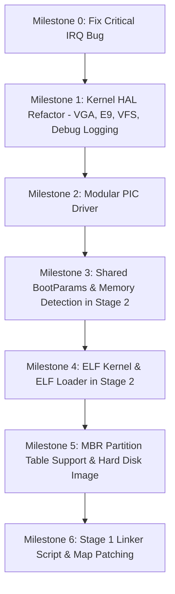

# myOS vs nanobyte_os: Architecture Comparison & Implementation Tracker

**Document Version:** 1.0  
**Created:** September 10, 2026  
**Last Updated:** September 10, 2026  
**Status:** In Progress — Tracking parity milestones with `nanobyte_os`

---

## 1. Executive Summary & Status Dashboard

| Component | myOS Current State | nanobyte_os Reference State | Parity Status | Next Step |
| :--- | :--- | :--- | :---: | :--- |
| **Stage 1 Bootloader** | Linked with `linker.ld`, dynamic `stage2_location` patching, preserves BPB, forwards MBR partition | Linked with `linker.ld`, symbol map patching, preserves BPB, forwards MBR partition | 🟢 Parity Achieved | Complete |
| **Stage 2 Bootloader** | Has MBR partition detection (`mbr.c`), E820 memory detection, BootParams, FAT12/16/32 with 5-sector cache, ELF32 loader | ELF32 parser (`/boot/kernel.elf`), MBR partition detection, E820 memory detection, FAT12/16/32 + cache + LFN | 🟢 Parity Achieved | Complete |
| **Kernel Binary & Entry** | ELF32 executable at 1MB, `start(BootParams*)`, calls `_init()` global ctors | ELF32 executable at 1MB, `start(BootParams*)`, calls `_init()` global ctors | 🟢 Parity Achieved | Complete |
| **Physical Memory Manager** | Bitmap frame allocator in HAL (`pmm.c`), 32-bit fast bit-scan, contiguous multi-page allocation | Basic memory primitives only (`memcpy`, `memset`, `memcmp`) | 🟢 Surpassed nanobyte_os | Complete |
| **Virtual Memory Manager** | Two-level x86 paging (`vmm.c`, `vmm_asm.asm`), recursive self-mapping, identity mapping, `#PF` handler | None | 🟢 Surpassed nanobyte_os | Complete |
| **Kernel Heap Allocator** | Boundary-tag dynamic allocator (`heap.c`), 8-byte alignment, block splitting, $O(1)$ coalescing, dynamic expansion (`kmalloc`, `kzalloc`, `kfree`, `krealloc`) | None | 🟢 Surpassed nanobyte_os | Complete |
| **MLFQ Task Scheduler** | 3-Level Multi-Level Feedback Queue preemptive & cooperative scheduler (`task.c`, `task.h`), hardware interrupt context switching (`isr.asm`), forged interrupt frames, anti-starvation periodic boost, deferred stack reaper | None | 🟢 Surpassed nanobyte_os | Complete |
| **Interactive Shell & Keyboard** | PS/2 keyboard driver (IRQ 1, scancode set 1 decoding, Shift/Caps/Ctrl tracking), circular key buffer, interactive command shell (`shell.c`, `shell.h`) with live task & memory diagnostics | None | 🟢 Surpassed nanobyte_os | Complete |
| **High-Resolution GUI & Mouse** | Bochs VBE/BGA 1024x768 @ 32bpp linear framebuffer, double-buffered 2D graphics engine, built-in 8x8 font, PS/2 mouse driver (IRQ 12), window manager with draggable windows & taskbar | None | 🟢 Surpassed nanobyte_os | Complete |
| **Ring 3 User Mode & Syscalls** | TSS hardware task state segment (`tss.c`), User Code (`0x1B`) & Data (`0x23`) segments, `int 0x80` syscall dispatcher (`syscall.c`, 9 system calls), user-space virtual memory isolation (`0x40000000`), hardware fault containment (`#GP`, `#PF`) | None | 🟢 Surpassed nanobyte_os | Complete |
| **Storage & FAT Filesystem (VFS)** | ATA PIO hard disk driver (`ata.c`), kernel FAT12/FAT16 filesystem driver (`fat.c`), POSIX-style VFS layer (`vfs.c`, `vfs.h`), VFS syscalls (`SYS_OPEN`, `SYS_CLOSE`, `SYS_READ_FILE`, etc.), disk shell commands (`ls`, `cat`, `touch`, `write`), and desktop File Explorer GUI window | None | 🟢 Surpassed nanobyte_os | Complete |
| **Dynamic ELF32 Binary Loader** | Kernel ELF32 loader (`elf_loader.c`), isolated per-process Page Directories (`0x40000000+`), System V i386 ABI initial user stack (`argc`/`argv`), process lifecycle (`Task_WaitPID`), dynamic process spawning (`sys_spawn`/`sys_waitpid`) | None | 🟢 Surpassed nanobyte_os | Complete |
| **Standard C Library (`libmyos`) & POSIX** | User-space dynamic heap allocator (`malloc`, `free`, `realloc`, `calloc`), standard stream abstraction (`FILE*`, `stdin`, `stdout`, `stderr`, `fopen`, `fclose`, `fread`, `fwrite`, `fseek`, `ftell`, `fgetc`, `fgets`, `fputs`, `fprintf`), POSIX string utilities (`strtok`, `strdup`, `qsort`, `rand`), user applications (`wc.elf`, `grep.elf`, `sh.elf`, `snake.elf`) | None | 🟢 Surpassed nanobyte_os | Complete |
| **Network Subsystem & Intel E1000 Driver** | Intel 82540EM Gigabit Ethernet PCI driver (`e1000.c`, `e1000.h`) with BAR0 MMIO, 32 Rx & 16 Tx DMA rings; lightweight network protocol stack: Ethernet framing, ARP with dynamic cache & auto-reply, IPv4 routing & checksums, ICMP echo request/reply (ping), and UDP (`net/`); syscalls `SYS_NET_INFO`, `SYS_NET_PING`, `SYS_NET_SEND_UDP`; user library network APIs; standalone Ring 3 apps `ifconfig.elf` and `ping.elf`; interactive shell commands `ifconfig` and `ping` | None | 🟢 Surpassed nanobyte_os | Complete |
| **POSIX Pipes, Redirection & IPC** | Circular kernel pipe buffer (`pipe.h`, `pipe.c`) with reader/writer ref counting and cooperative blocking; per-process file descriptor virtualization (`fd_table[16]`) with fork/spawn inheritance; syscalls `SYS_PIPE` (22), `SYS_DUP` (23), `SYS_DUP2` (24); POSIX stream pipelines (`|`) and file redirections (`<`, `>`, `>>`) in kernel shell and Ring 3 user subshell; stdin-aware utilities (`cat`, `wc`, `grep`) and standalone user utilities `/bin/tee.elf`, `/bin/head.elf` | None | 🟢 Surpassed nanobyte_os | Complete |
| **TCP Protocol Stack & BSD Sockets** | RFC 793 TCP state machine (`CLOSED`, `LISTEN`, `SYN_SENT`, `SYN_RECEIVED`, `ESTABLISHED`, `FIN_WAIT_1`, `CLOSE_WAIT`, `LAST_ACK`, `TIME_WAIT`) in `tcp.c`/`tcp.h`; 32 socket pool; checksum calculation with pseudo-header; sliding window streaming; VFS socket abstraction (`VFS_TYPE_SOCKET`) integrated with `vfs_read`, `vfs_write`, `vfs_close`; BSD socket syscalls `SYS_SOCKET` (25), `SYS_BIND` (26), `SYS_LISTEN` (27), `SYS_CONNECT` (28), `SYS_ACCEPT` (29), `SYS_SEND` (30), `SYS_RECV` (31); user library BSD socket API; standalone Ring 3 applications `/bin/curl.elf` and `/bin/httpd.elf` | None | 🟢 Surpassed nanobyte_os | Complete |
| **POSIX Signals & Job Control** | Asynchronous signal delivery engine (`signal.h`, `task.c`, `isr.c`); user stack signal trampoline (`SigFrame`, `SigContext`); context restoration syscall `SYS_SIGRETURN` (35); signal management syscalls `SYS_KILL` (32), `SYS_SIGNAL` (33), `SYS_SIGACTION` (34), `SYS_ALARM` (36), `SYS_PAUSE` (37); terminal `Ctrl+C` delivering `SIGINT`; hardware fault redirection (`#GP`/`#PF` -> `SIGSEGV`/`SIGILL`); user library signal APIs (`signal`, `sigaction`, `kill`, `alarm`, `pause`); standalone utilities `/bin/alarm.elf` and `/bin/trap.elf` | None | 🟢 Surpassed nanobyte_os | Complete |
| **Graphical Window Server & Ecosystem** | Kernel-level window server & display compositor (`gui.h`/`gui.c`), accelerated 2D blitter (`GFX_BlitBuffer`), zero-copy shared client backbuffers mapped at `0x60000000 + ID*0x400000`, circular per-window input event queues (`gui_event_t`), automatic window destruction & reclamation in scheduler reaper, GUI syscalls `SYS_GUI_CREATE_WIN` (38) through `SYS_GUI_MAP_BUFFER` (42), user GUI toolkit library (`libgui.h`, `libgui.c`), standalone Ring 3 GUI apps (`notepad.elf`, `sysmon.elf`, `paint.elf`) | None | 🟢 Surpassed nanobyte_os | Complete |
| **Symmetric Multiprocessing (SMP) & APIC** | ACPI RSDP/RSDT & MADT ('APIC') hardware core enumeration, Local APIC MMIO driver with MSR hardware/software enable, I/O APIC 24-entry redirection driver, real-mode AP trampoline at `0x8000` (SIPI vector `0x08`), INIT-SIPI-SIPI wake-up protocol with online handshake, atomic compare-and-swap spinlocks (`spinlock.c`/`spinlock.h`), `SYS_SMP_INFO` syscall (43), user library API, standalone Ring 3 utility `/bin/smpinfo.elf`, and interactive shell `smp` command | None | 🟢 Surpassed nanobyte_os | Complete |
| **Sound Blaster 16 & Retro Gaming** | Direct DSP I/O driver (`0x220`–`0x22F`), ISA 8237 DMA Channel 1 (8-bit) and Channel 5 (16-bit) double-buffering, low-memory DMA buffer below 16MB with 64 KiB boundary enforcement, IRQ 5 handling, audio mixer (Master/PCM volume), audio syscalls `SYS_AUDIO_PLAY` (44) through `SYS_AUDIO_SET_VOL` (47), user runtime WAV parser (`audio_play_wav`), `/bin/play.elf` audio player, and classic retro games: `/bin/tetris.elf`, `/bin/snake.elf` (interactive), and `/bin/doom.elf` (3D raycasting FPS with 3 levels, 3 enemy types, and SB16 sound effects) | None | 🟢 Surpassed nanobyte_os | Complete |
| **Kernel Interrupts & PIC** | Modular `PICDriver` interface (`i8259.c`), auto-unmasking, ISR bound | Modular `PICDriver` interface, `i8259` driver with probe, proper ISR routing | 🟢 Parity Achieved | Ready for APIC in future |
| **HAL & Drivers** | Clean `vga_text.c`, port 0xE9 (`e9.c`), `vfs.c` router, structured `debug.c`, `pmm.c`, `vmm.c`, `heap.c` | Separated `vga_text.c`, port 0xE9 debug (`e9.c`), minimal `vfs.c`, structured logger (`debug.c`) | 🟢 Parity Achieved | Complete |
| **Shared Libs (`libs/`)** | `src/libs/boot/bootparams.h` shared across Stage 2 & Kernel | `src/libs/boot/bootparams.h`, `src/libs/core/` (C++ device abstractions) | 🟡 BootParams Parity | Add C++ core library (optional) |
| **Build & Tooling** | CMake + Makefile; dynamic bootloader patching via `install_bootloader.py` | SCons; disk image tool supports Floppy & MBR Hard Drive with dynamic patching | 🟢 Parity Achieved | Complete |

---

## 2. Component-by-Component Detailed Comparison

### Component 1: Bootloader Stage 1 (`src/bootloader/stage1/`)

#### Comparison Matrix
| Feature | `nanobyte_os` | `myOS` | Impact / Assessment |
| :--- | :--- | :--- | :--- |
| **Build Mechanism** | `nasm -f elf` + `i686-elf-ld -T linker.ld` | `nasm -f bin boot.asm -o boot.bin` | `nanobyte_os` produces symbol map (`stage1.map`) with exact offsets of symbols (`stage2_location`, `__entry_start`). |
| **Filesystem Header (BPB)** | Preserved during installation; skips BPB bytes so `mkfs.fat` BPB is intact | Overwritten completely by `dd` with `boot.bin`; requires hardcoded BPB to match filesystem params | Overwriting BPB risks breaking on non-standard geometry or when switching filesystem formats. |
| **Stage 2 Location** | Patched dynamically by image builder into `stage2_location` (LBA + sector count) | Hardcoded in assembly: reads 32 sectors starting from LBA 1 | In `myOS`, if `stage2.bin` grows > 16 KB (32 sectors), bootloader fails or truncates. |
| **MBR Partition Forwarding** | Reads `DS:SI` from MBR, saves to `0x2000:0x0000`, passes to Stage 2 in `DI:SI` | Discards `DS:SI`; only saves `DL` (drive ID) | `myOS` cannot support bootable MBR partitions on hard drives. |
| **Disk Read Modes** | LBA extensions (`int 13h ah=42h`) + CHS fallback (`ah=02h`) with disk reset on error | LBA extensions + CHS fallback with retry | Both support LBA and CHS. `nanobyte_os` includes disk controller reset (`ah=00h`). |

#### Actionable Improvements for Stage 1:
- [x] **1.1:** Add `linker.ld` for Stage 1 to produce an ELF object and map file.
- [x] **1.2:** Store `DS:SI` partition entry at `0x2000:0000` and pass partition pointer to Stage 2.
- [x] **1.3:** Replace hardcoded 32-sector read with dynamic `stage2_location` populated by the build system.
- [x] **1.4:** Update disk image generation to patch boot sector without overwriting the formatted BPB.

---

### Component 2: Bootloader Stage 2 (`src/bootloader/stage2/`)

#### Comparison Matrix
| Feature | `nanobyte_os` | `myOS` | Impact / Assessment |
| :--- | :--- | :--- | :--- |
| **Entry Arguments** | `start(uint16_t bootDrive, void* partition)` | `start(uint16_t bootDrive, void* partition)` | Both receive partition entry pointer. |
| **Partition Layer** | `mbr.c` / `mbr.h` (`Partition` struct) | `mbr.c` / `mbr.h` (`Partition` struct) | Both abstract disk offset so floppy and hard disk partitions work identically. |
| **FAT Capabilities** | FAT12, FAT16, FAT32 support, 5-sector cache, Long File Name (LFN) decoding | FAT12, FAT16, FAT32 support, 5-sector cache | Parity achieved for filesystem reading and caching. |
| **Memory Detection** | E820 BIOS call (`x86_E820GetNextBlock`) builds `MemoryInfo` array | E820 BIOS call builds `MemoryInfo` array | Complete memory detection parity. |
| **Kernel Binary Format** | ELF32 (`elf.c`, `elf.h`) loading `/boot/kernel.elf` | ELF32 (`elf.c`, `elf.h`) loading `/boot/kernel.elf` | Both inspect `PT_LOAD`, auto-clear BSS, and jump to ELF entry. |
| **Boot Parameters** | Constructs `BootParams` (boot device, memory regions) and passes to kernel | Constructs `BootParams` and passes to kernel | Full parity. |
| **CRT Support** | `crti.asm`, `crtn.asm`, calls `_init()` | `crti.asm`, `crtn.asm`, calls `_init()` | Parity achieved. |
| **Standard Utilities** | Has `stdlib.c` (`qsort`) | None | Useful for sorting memory regions and directory entries. |

#### Actionable Improvements for Stage 2:
- [x] **2.1:** Implement MBR partition abstraction (`mbr.c` / `mbr.h`).
- [x] **2.2:** Add E820 BIOS memory map detection (`x86_E820GetNextBlock`, `memdetect.c`, `memdetect.h`).
- [x] **2.3:** Implement ELF32 loader (`elf.c`, `elf.h`) to parse `/boot/kernel.elf`.
- [x] **2.4:** Pass `BootParams*` struct containing boot device and memory regions to kernel.
- [x] **2.5:** Upgrade FAT driver to support FAT16/FAT32 and sector caching.
- [x] **2.6:** Fix enum typo in `fat.h` (`FAT_ATTRIVURE_*` -> `FAT_ATTRIBUTE_*`).

---

### Component 3: Kernel Architecture & Subsystems (`src/kernel/`)

#### Comparison Matrix
| Feature | `nanobyte_os` | `myOS` | Impact / Assessment |
| :--- | :--- | :--- | :--- |
| **Executable Format** | `elf32-i386` (`kernel.elf`) | Flat binary (`kernel.bin`) | Standard format allows inspection with `readelf`, `objdump`, and GDB debugging with symbols. |
| **Entry Signature** | `void start(BootParams* bootParams)` | `void start(uint16_t bootDrive)` | Receives system memory map and hardware metadata. |
| **Global Constructors** | Calls `_init()` via `crti.asm` / `crtn.asm` | None | Enables C++ runtime and static constructors. |
| **Interrupt Registration** | `i686_ISR_RegisterHandler(PIC_REMAP_OFFSET + i, i686_IRQ_Handler)` | **BUG:** `i686_IRQ_RegisterHandler(PIC_REMAP_OFFSET + i, ...)` | **CRITICAL:** `myOS` writes 32 elements out-of-bounds in `g_IRQHandlers` and never binds IRQs to ISRs. |
| **PIC Architecture** | Abstract `PICDriver` (`i8259.c` implements driver interface) | Monolithic `pic.c` / `pic.h` | Modular design allows adding APIC without rewriting IRQ logic. |
| **VGA Display** | Dedicated `arch/i686/vga_text.c` & `vga_text.h` | Entangled in `stdio.c` | Decouples video hardware from formatted text streams. |
| **Debug Console** | Hardware port 0xE9 emulator driver (`e9.c`, `e9.h`) | None | Allows printing kernel logs directly to terminal in QEMU / Bochs. |
| **VFS Layer** | Minimal `vfs.c` (STDIN, STDOUT, STDERR, DEBUG) | None | Standardized file descriptor output routing. |
| **Structured Logging** | `debug.c` / `debug.h` (`log_debug`, `log_info`, `log_warn`, `log_err`, `log_crit`) | None | Colored ANSI logs with module tags and log levels. |

#### Actionable Improvements for Kernel:
- [ ] **3.1 (CRITICAL BUG FIX):** Fix line 38 in `src/kernel/arch/i686/irq.c` from `i686_IRQ_RegisterHandler` to `i686_ISR_RegisterHandler`.
- [ ] **3.2:** Separate `vga_text.c` from `stdio.c` and expose `VGA_clrscr()`, `VGA_putc()`.
- [ ] **3.3:** Implement Port 0xE9 debug output driver (`e9.c`, `e9.h`).
- [ ] **3.4:** Implement minimal VFS router (`vfs.c`, `vfs.h`) and update `stdio.c` to use `VFS_Write`.
- [ ] **3.5:** Implement structured logger (`debug.c`, `debug.h`).
- [ ] **3.6:** Convert PIC subsystem into modular `PICDriver` interface + `i8259` driver.
- [ ] **3.7:** Convert kernel linker script to `elf32-i386`, add `crti.asm` / `crtn.asm`, and accept `BootParams*`.

---

### Component 4: Shared Libraries & C++ Foundation (`src/libs/`)

#### Comparison Matrix
| Feature | `nanobyte_os` | `myOS` | Impact / Assessment |
| :--- | :--- | :--- | :--- |
| **Shared Boot Headers** | `src/libs/boot/bootparams.h` (shared by Stage 2 & Kernel) | None | Single source of truth for boot parameter structs. |
| **C++ Core Library** | `src/libs/core/` (OO abstractions for devices, files, I/O) | None | Modern C++ object-oriented design for device drivers. |

#### Actionable Improvements for Libs:
- [ ] **4.1:** Create `src/libs/boot/bootparams.h` for shared memory map and boot data structures.
- [ ] **4.2:** (Optional Future) Introduce `src/libs/core/` for C++ device abstraction classes (`TextDevice`, `BlockDevice`).

---

### Component 5: Build System & Tooling

#### Comparison Matrix
| Feature | `nanobyte_os` | `myOS` | Assessment |
| :--- | :--- | :--- | :--- |
| **Build Tool** | SCons (Python-based) | CMake + Make | Both are good; CMake is standard in modern C/C++ projects. |
| **Cross-Compiler** | `i686-elf-gcc`, `i686-elf-g++` | `i686-elf-gcc`, `i686-elf-g++` | Both properly configured with cross-toolchain. |
| **Image Formatting** | Python script with `parted`, `mkfs.fat`, map symbol patching | Shell commands (`dd`, `mkfs.fat`, `mcopy`) | `nanobyte_os` is more resilient to binary size changes. |
| **Target Images** | Floppy (1.44MB) & Hard Disk (MBR partitioned) | Floppy only | Need hard disk MBR image target. |
| **QEMU Integration** | Scripts support Bochs & QEMU with serial/debugcon | Basic QEMU run command | Add `-debugcon stdio` to capture Port 0xE9 logs. |

---

## 3. Step-by-Step Implementation Roadmap

### Phase 1: Stability & Kernel Modernization
- [x] **Step 1.1:** Fix `irq.c` registration bug to eliminate `Unhandled interrupt 32!` crash.
- [x] **Step 1.2:** Split `src/kernel/stdio.c` into `arch/i686/vga_text.c` and clean `stdio.c`.
- [x] **Step 1.3:** Add `arch/i686/e9.c` (Port 0xE9 emulator debug output).
- [x] **Step 1.4:** Add `hal/vfs.c` (routing stdout to VGA and debug to E9).
- [x] **Step 1.5:** Add `debug.c` / `debug.h` (ANSI colored logging: `log_debug`, `log_info`, `log_warn`, `log_err`, `log_crit`).
- [x] **Step 1.6:** Refactor PIC into `PICDriver` interface and `i8259.c`.

### Phase 2: Memory Detection & Boot Parameter Passing
- [x] **Step 2.1:** Create `src/libs/boot/bootparams.h` with `MemoryRegion`, `MemoryInfo`, `BootParams`.
- [x] **Step 2.2:** Add `x86_E820GetNextBlock` in `stage2/x86.asm` and `x86.h`.
- [x] **Step 2.3:** Add `stage2/memdetect.c` to populate memory map and print memory regions during boot.

### Phase 3: ELF Binary Support
- [x] **Step 3.1:** Implement ELF32 header parser and program header loader in `stage2/elf.c` and `elf.h`.
- [x] **Step 3.2:** Update kernel `linker.ld` to output `elf32-i386` as `kernel.elf`.
- [x] **Step 3.3:** Update `stage2/main.c` to load `/boot/kernel.elf` and pass `&g_BootParams` to `kernelEntry`.
- [x] **Step 3.4:** Add CRT init/fini files (`crti.asm`, `crtn.asm`) to Kernel with strict toolchain linking order.
- [x] **Step 3.5:** Update kernel `main.c` to call `_init()`, accept `BootParams* bootParams`, and log detected memory regions.

### Phase 4: Disk & MBR Hard Drive Support
- [x] **Step 4.1:** Add `stage2/mbr.c` / `mbr.h` (`Partition` struct and sector offset handling).
- [x] **Step 4.2:** Update `stage2/fat.c` to support FAT16/32, 5-sector FAT cache, and fix enum typo in `fat.h`.
- [x] **Step 4.3:** Add Stage 1 `linker.ld` producing `boot.map` and dynamic `stage2_location` patching.
- [x] **Step 4.4:** Integrate `build_scripts/install_bootloader.py` to preserve formatted BPB and dynamically patch sector counts.

### Phase 5: Physical Memory Manager (PMM)
- [x] **Step 5.1:** Update `src/kernel/memory.h` and `src/kernel/memory.c` with 32-bit `size_t` signatures.
- [x] **Step 5.2:** Define `MEMORY_TYPE_*` standard macros in `src/libs/boot/bootparams.h`.
- [x] **Step 5.3:** Create `src/kernel/hal/pmm.h` with page constants, alignment macros, and PMM prototypes (`PMM_Initialize`, `PMM_AllocatePage`, `PMM_AllocatePages`, `PMM_FreePage`, `PMM_FreePages`, memory queries).
- [x] **Step 5.4:** Implement `src/kernel/hal/pmm.c` placing dynamic bitmap at `PAGE_ALIGN_UP(__end)`, parsing E820 usable regions, reserving lower 1 MB + kernel ELF + bitmap, and optimizing allocation via 32-bit dword scanning and `__builtin_ctz`.
- [x] **Step 5.5:** Update `src/kernel/main.c` to initialize PMM and execute test allocations (single page allocation, write-verification, recycling test, multi-page contiguous allocation, and freeing).

### Phase 6: Virtual Memory Manager (VMM) & Paging
- [x] **Step 6.1:** Create `src/kernel/arch/i686/vmm_asm.asm` with low-level assembly routines (`i686_VMM_LoadPageDirectory`, `i686_VMM_EnablePaging`, `i686_VMM_DisablePaging`, `i686_VMM_FlushTLB`, `i686_VMM_GetFaultAddress`, `i686_VMM_IsPagingEnabled`).
- [x] **Step 6.2:** Create `src/kernel/hal/vmm.h` with bitflags (`PAGE_PRESENT`, `PAGE_WRITE`, `PAGE_USER`, `PAGE_CACHE_DISABLE`), recursive self-mapping macros (`0xFFFFF000`), and VMM prototypes.
- [x] **Step 6.3:** Implement `src/kernel/hal/vmm.c` allocating Kernel Page Directory from PMM, identity mapping all detected physical RAM (32 page tables = 128 MB), configuring recursive self-mapping at PDE 1023, registering `#PF` (ISR 14) exception handler with `CR2` decoding, loading `CR3`, and enabling `CR0.PG` & `CR0.WP`.
- [x] **Step 6.4:** Implement dynamic page mapping (`VMM_MapPage`) with on-demand Page Table allocation and TLB flushing (`invlpg`), address unmapping (`VMM_UnmapPage`), and physical address resolution (`VMM_GetPhysicalAddress`).
- [x] **Step 6.5:** Update `src/kernel/main.c` to initialize VMM and run verification tests (verify `CR0.PG = 1`, map virtual `0x80000000` to physical frame, write/read memory verification, address translation query, and unmapping).

### Phase 7: Kernel Dynamic Memory Allocator / Heap
- [x] **Step 7.1:** Create `src/kernel/hal/heap.h` defining 24-byte 8-byte aligned `BlockHeader`, heap limits (base `0x10000000`, initial 1 MiB, max 64 MiB), magic signature (`0x1EA91337`), and heap prototypes (`kmalloc`, `kzalloc`, `kfree`, `krealloc`, memory queries).
- [x] **Step 7.2:** Implement `src/kernel/hal/heap.c` with first-fit free list traversal, 8-byte payload alignment, block splitting on allocation, and $O(1)$ bidirectional coalescing on free with magic verification.
- [x] **Step 7.3:** Implement dynamic demand expansion (`kheap_expand`) allocating physical frames via PMM and mapping them into the heap virtual window via VMM (`VMM_MapPage`).
- [x] **Step 7.4:** Implement `kzalloc` (zeroed memory) and `krealloc` (in-place check and reallocation with payload preservation).
- [x] **Step 7.5:** Integrate `KHeap_Initialize()` into `src/kernel/main.c` and execute verification test suite (variable-sized allocations, alignment validation, `kzalloc` zero check, `krealloc` preservation, $O(1)$ coalescing back to baseline, and dynamic expansion with a 1.5 MiB allocation).

### Phase 8: Multi-Level Feedback Queue (MLFQ) Preemptive & Cooperative Task Scheduler
- [x] **Step 8.1:** Update `src/kernel/arch/i686/isr.asm` replacing `add esp, 4` with `mov esp, eax` to enable zero-cost stack switching on interrupt return for preemptive timer interrupts and voluntary yields.
- [x] **Step 8.2:** Update `src/kernel/arch/i686/isr.h` and `isr.c` signature to `Registers* i686_ISR_Handler(Registers* regs)` and route timer IRQ 0 (32) and voluntary yield `int $0x81` (129) to `Task_Schedule(regs)`.
- [x] **Step 8.3:** Create `src/kernel/hal/task.h` defining 3 MLFQ priority queues (Q0: 2 ticks, Q1: 6 ticks, Q2: 15 ticks), Task Control Block (`Task` struct), states (`TASK_READY`, `TASK_RUNNING`, `TASK_SLEEPING`, `TASK_TERMINATED`), and scheduler public APIs.
- [x] **Step 8.4:** Implement `src/kernel/hal/task.c` with dynamic stack forging (`Task_Trampoline`, initial registers with IF=1, dummy return address, argument forwarding), 100 Hz PIT programming, interactive priority preservation (Rule 4b), compute quantum expiration demotion (Rule 4a), anti-starvation periodic priority boost every 100 ticks (Rule 5), and deferred stack reaper resolving the suicide paradox.
- [x] **Step 8.5:** Integrate `Task_Initialize` and comprehensive MLFQ concurrency test suite in `src/kernel/main.c` verifying interactive yielding, compute demotion from Q0 -> Q1 -> Q2, clean task termination via `Task_Exit()`, reaper deallocation, and formatted MLFQ statistics reporting (`Task_DumpStats()`).

### Phase 9: PS/2 Keyboard Driver & Interactive Command Shell
- [x] **Step 9.1:** Implement PS/2 keyboard controller driver in `src/kernel/arch/i686/keyboard.h` and `keyboard.c` with Scan Code Set 1 mapping, Shift/Caps/Ctrl state tracking, and 256-byte circular FIFO ring buffer.
- [x] **Step 9.2:** Register IRQ 1 handler in `i686_Keyboard_Initialize` via `i686_IRQ_RegisterHandler`, unmasking keyboard interrupts on the 8259 PIC.
- [x] **Step 9.3:** Add backspace (`\b`) cursor repositioning to `vga_text.c` for interactive terminal line editing.
- [x] **Step 9.4:** Add `Task_Kill(pid)` to `task.h` and `task.c` for dynamic task termination from the shell.
- [x] **Step 9.5:** Implement interactive command shell in `src/kernel/hal/shell.h` and `shell.c` (`help`, `clear`, `ps`, `mem`, `spawn`, `kill`, `stats`, `echo`, `reboot`) running as an interactive task in MLFQ Queue 0.
- [x] **Step 9.6:** Integrate keyboard & shell into `HAL_Initialize()` and `main.c`, verifying live interactive command line execution and task spawning in QEMU.

### Phase 10: High-Resolution Graphical User Interface (GUI) & Mouse Subsystem
- [x] **Step 10.1:** Extend Port I/O with 16-bit word (`i686_outw`, `i686_inw`) and 32-bit dword (`i686_outd`, `i686_ind`) operations in `src/kernel/arch/i686/io.asm` and `io.h`.
- [x] **Step 10.2:** Implement PCI configuration space manager (`pci.h`, `pci.c`) on ports `0xCF8`/`0xCFC` with device enumeration and dynamic BAR lookup.
- [x] **Step 10.3:** Fix Slave PIC cascade unmasking in `i8259_Unmask` (`i8259.c`) so Master PIC IRQ 2 is unmasked when enabling slave interrupts (IRQ 8-15).
- [x] **Step 10.4:** Implement Bochs Graphics Adapter driver (`bga.h`, `bga.c`) on ports `0x01CE`/`0x01CF`, supporting 1024x768 @ 32bpp video mode, dynamic PCI BAR0 discovery (`0xFD000000`), and virtual memory mapping via `VMM_MapPage`.
- [x] **Step 10.5:** Implement PS/2 mouse controller driver (`mouse.h`, `mouse.c`) on IRQ 12 with 3-byte packet decoding, button state tracking, coordinate clamping, and synthetic event injection.
- [x] **Step 10.6:** Implement 2D Graphics Engine (`gfx.h`, `gfx.c`) with double-buffering in Kernel Heap, drawing primitives (lines, rectangles, circles, alpha blending), embedded 8x8 ASCII font, clipping rectangle support, and mouse pointer sprite rendering.
- [x] **Step 10.7:** Implement Desktop Window Manager and Compositor (`gui.h`, `gui.c`) running as an autonomous task in MLFQ Queue 0, featuring a modern slate desktop, bottom taskbar with start button and system status tray, and draggable windows with drop shadows, title bars, and close buttons (`MLFQ Scheduler`, `System Memory`, `Terminal Log`, `About myOS`).
- [x] **Step 10.8:** Integrate `gui` command into the Phase 9 shell and verify 1024x768 @ 32bpp framebuffer rendering and title-bar dragging in QEMU via screendump.

### Phase 11: Ring 3 User Mode, Task State Segment (TSS) & Syscall Subsystem (`int 0x80`)
- [x] **Step 11.1:** Extend GDT in `gdt.h`, `gdt.c`, and `gdt.asm` with User Code Segment (`0x18 | 3 = 0x1B`), User Data Segment (`0x20 | 3 = 0x23`), and TSS descriptor (`0x28`). Implement `i686_LTR` assembly primitive (`ltr ax`).
- [x] **Step 11.2:** Implement Task State Segment (TSS) subsystem (`tss.h`, `tss.c`) configuring kernel stack segment `ss0 = 0x10`, empty I/O bitmap base, and dynamic per-task kernel stack pointer updating (`TSS_SetKernelStack`).
- [x] **Step 11.3:** Implement Syscall Gateway (`syscall.h`, `syscall.c`) configuring IDT gate `0x80` with Ring 3 privilege (`IDT_FLAG_RING3`, `0xEE`), argument dispatching (EAX=syscall, EBX=arg1, ECX=arg2, EDX=arg3), and standard syscalls (`SYS_EXIT`, `SYS_PRINT`, `SYS_READ`, `SYS_YIELD`, `SYS_GETPID`, `SYS_SLEEP`, `SYS_GETTICKS`, `SYS_SBRK`, `SYS_BEEP`).
- [x] **Step 11.4:** Implement User Task Creation (`Task_CreateUser`) in `task.h` and `task.c`, allocating a dedicated 4 KiB kernel stack, mapping dedicated user-space code and stack pages at `0x40000000 + (PID * 0x20000)` with `PAGE_PRESENT | PAGE_WRITE | PAGE_USER`, and forging Ring 3 interrupt return frames (`CS=0x1B`, `SS=0x23`, `EFLAGS=0x0202`).
- [x] **Step 11.5:** Implement hardware fault containment in `isr.c` and `vmm.c`: detect Ring 3 exceptions (`regs->cs & 3 == 3`) and user page faults (`user` error bit), log user process diagnostics, terminate offending task cleanly via `Task_Exit()`, and yield without panicking the kernel.
- [x] **Step 11.6:** Implement non-busy `SYS_SLEEP` scheduling with `wake_tick` tracking in MLFQ scheduler, and deferred reaping of user-mode physical frames and virtual page mappings upon task exit.
- [x] **Step 11.7:** Create embedded position-independent assembly test programs in `user_programs.asm` (`user_program_hello`, `user_program_counter`, `user_program_fault_gp`, `user_program_fault_pf`), integrate `user` command in shell, and verify execution in QEMU.

### Phase 12: Storage Device Subsystem (IDE / ATA PIO Driver), FAT Filesystem, VFS Layer, and Desktop File Explorer
- [x] **Step 12.1:** Implement IDE / ATA PIO 28-bit LBA disk controller driver (`ata.h`, `ata.c`) supporting Primary Master/Slave ATA bus (`0x1F0`–`0x1F7`, `0x3F6`), `IDENTIFY` command (`0xEC`), sector read (`0x20`), sector write (`0x30`), and cache flush (`0xE7`).
- [x] **Step 12.2:** Implement freestanding kernel string library (`string.h`, `string.c`) providing `strlen`, `strcmp`, `strncmp`, `strcpy`, `strncpy`, and `strchr`.
- [x] **Step 12.3:** Implement kernel FAT filesystem driver (`fat.h`, `fat.c`) supporting BPB parsing from sector 0, dynamic FAT12/FAT16 detection, cached FAT table reads and writes, path resolution, root directory enumeration, file creation (`FAT_CreateFile`), dynamic cluster allocation with linked-list traversal, write truncation, and file resizing.
- [x] **Step 12.4:** Implement standard Virtual File System (VFS) Layer (`vfs.h`, `vfs.c`) managing file descriptors (`fd 0..3` for stdin/stdout/stderr/debug, `fd 4..19` for open files), `vfs_open`, `vfs_read`, `vfs_write`, `vfs_close`, `vfs_readdir`, `vfs_stat`, and `vfs_touch`.
- [x] **Step 12.5:** Extend Ring 3 System Call subsystem (`syscall.h`, `syscall.c`) with VFS system calls: `SYS_OPEN` (10), `SYS_CLOSE` (11), `SYS_READ_FILE` (12), `SYS_WRITE_FILE` (13), `SYS_READDIR` (14), `SYS_STAT` (15), complete with user-space C wrapper functions.
- [x] **Step 12.6:** Add interactive storage commands to the shell (`shell.c`): `disk` (drive hardware info, sectors, capacity), `ls [path]` (directory enumeration with sizes and types), `cat <file>` (display file content), `touch <file>` (create empty file), and `write <file> <text...>` (write or append text).
- [x] **Step 12.7:** Implement interactive Desktop File Explorer GUI window (`gui.c`) rendering dynamic file lists with folder/file icons, file sizes, and responsive window dragging in the 1024x768 32bpp compositor.
- [x] **Step 12.8:** Fix Stage 2 Protected Mode Segment Registers (`es`, `fs`, `gs` loaded with selector 0x10) and Stage 2 memory size types (`memcpy`/`memset`/`memcmp` size parameter upgraded from `uint16_t` to `uint32_t`), resolving 64KB kernel truncation and triple faults.

### Phase 13: ELF32 User Executable Dynamic Binary Loader, User Runtime, and Standalone Applications
- [x] **Step 13.1:** Implement file seeking primitives in FAT driver (`FAT_Seek`, `FAT_SeekEx`, `FAT_Tell`, `FAT_GetSize` in `fat.h`, `fat.c`) and POSIX `vfs_lseek` (`VFS_SEEK_SET`, `VFS_SEEK_CUR`, `VFS_SEEK_END` in `vfs.h`, `vfs.c`).
- [x] **Step 13.2:** Implement Kernel ELF32 Loader Subsystem (`elf_loader.h`, `elf_loader.c`) validating 32-bit little-endian ELF headers, allocating isolated per-process Page Directories (`pd_phys`) sharing kernel identity mappings, loading `PT_LOAD` segments, zero-filling `.bss`, allocating 16 KiB user stack (`0x400FC000`–`0x40100000`), and tracking physical frames and page tables for safe reclamation.
- [x] **Step 13.3:** Extend Task Scheduler & Process Architecture (`task.h`, `task.c`) with `Task_CreateUserFromELF`, setting up System V i386 ABI initial user stack frame with `argc`, `argv` string pointers, NULL-terminated `argv` array, and forging Ring 3 IRET frames (`CS=0x1B`, `SS=0x23`, `EFLAGS=0x0202`).
- [x] **Step 13.4:** Implement Process Lifecycle & Waiting (`Task_Find`, `Task_WaitPID`, `Task_ExitWithCode`, `waitable`/`reapable` zombie protection) preventing premature task reclamation, and hardware `CR3` page directory switching in `Task_Schedule`.
- [x] **Step 13.5:** Extend System Call Gateway (`syscall.h`, `syscall.c`) with `SYS_SPAWN` (16) and `SYS_WAITPID` (17) for dynamic child process creation and exit status collection.
- [x] **Step 13.6:** Implement User-Space Runtime & Standard Library:
  - Linker script `src/user/linker.ld` (virtual address base `0x40000000`, entry `_start`).
  - CRT0 assembly stub `src/user/crt0.asm` (extracts `argc`/`argv`, calls `main`, invokes `sys_exit`).
  - Freestanding user C library `libuser.h`, `libuser.c` (syscall wrappers, string utilities, formatted `printf`).
- [x] **Step 13.7:** Implement Standalone User Applications:
  - `hello.c`: Displays PID, execution ring, and CLI arguments.
  - `calc.c`: Command-line arithmetic calculator (`+`, `-`, `*`, `/`, `%`) returning result as process exit code.
  - `counter.c`: Countdown timer loop utilizing `sys_sleep(10)` syscalls and exiting with status 42.
  - `cat.c`: Standalone file viewer reading disk files via `sys_open`/`sys_read_file` syscalls.
- [x] **Step 13.8:** Integrate ELF Executable Execution in Interactive Shell (`shell.c`) with `exec <filepath> [args...]` and automatic command search fallback (`<cmd>`, `/bin/<cmd>`, `/bin/<cmd>.elf`).
- [x] **Step 13.9:** Automate build integration in root `CMakeLists.txt` and `src/user/CMakeLists.txt`, copying compiled binaries to disk image under `/bin/`.

### Phase 14: Standard C Library (`libmyos`), POSIX Subsystem Expansion & User Applications
- [x] **Step 14.1:** Implement User Dynamic Memory Allocator (`malloc`, `free`, `realloc`, `calloc`) in `src/user/libuser.c` & `libuser.h` using boundary-tag metadata, block splitting, bidirectional $O(1)$ coalescing, and dynamic expansion via `SYS_SBRK` (7).
- [x] **Step 14.2:** Implement POSIX Standard Streams and File I/O (`FILE*`, `stdin`, `stdout`, `stderr`, `fopen`, `fclose`, `fread`, `fwrite`, `fseek`, `ftell`, `fgetc`, `fputc`, `fgets`, `fputs`, `feof`, `ferror`) built on top of user syscall wrappers.
- [x] **Step 14.3:** Implement Standard Formatted Output and String Utilities (`vsnprintf`, `snprintf`, `sprintf`, `vfprintf`, `fprintf`, `printf`, `memset`, `memcpy`, `memmove`, `memcmp`, `strlen`, `strcpy`, `strncpy`, `strcmp`, `strncmp`, `strcat`, `strncat`, `strchr`, `strrchr`, `strstr`, `strtok`, `strdup`, `atoi`, `atol`, `itoa`, `qsort`, `rand`, `srand`).
- [x] **Step 14.4:** Extend Kernel VFS & Syscall Subsystem with `sys_lseek` (`SYS_SEEK` 18) supporting `SEEK_SET`, `SEEK_CUR`, and `SEEK_END`, and dynamically map user heap frames and page tables in `SYS_SBRK` with deferred reaper tracking.
- [x] **Step 14.5:** Implement Standalone User Applications in `src/user/apps/`:
  - `wc.c`: Counts lines, words, and characters in files using `FILE*` streams.
  - `grep.c`: Pattern matching and substring search using `fgets` and `strstr`.
  - `snake.c`: Ring 3 game simulation utilizing dynamic heap-allocated linked lists (`malloc`/`free`).
  - `sh.c`: Ring 3 user subshell with built-ins (`cd`, `pwd`, `help`, `exit`) and batch command execution (`-c`) using `sys_spawn` and `sys_waitpid`.
- [x] **Step 14.6:** Upgrade Kernel Task Stack to 8 KiB (`TASK_STACK_SIZE 8192`) and dynamically allocate ELF loader metadata to prevent stack overflow on deep VFS/ATA call chains.
- [x] **Step 14.7:** Automate compilation of all 8 user applications into floppy disk image under `::bin/` and verify complete test suite in QEMU.

### Phase 15: Network Device Driver (Intel 82540EM E1000) & Protocol Stack (Ethernet, ARP, IPv4, ICMP, UDP)
- [x] **Step 15.1:** Implement Intel 82540EM (e1000) Gigabit Ethernet PCI driver (`e1000.h`, `e1000.c`):
  - Scan PCI for vendor `0x8086` and device `0x100E`, configure PCI Bus Master, I/O, and Memory Space (`0x07`).
  - Map 128 KiB BAR0 MMIO space at virtual address `0xFE000000` via `VMM_MapPage`.
  - Read MAC address from RAL0/RAH0 or EEPROM (`EERD`), configure RAL0/RAH0 with Address Valid (`AV`) bit.
  - Allocate 32 Rx descriptors (512B) and 16 Tx descriptors (256B) on 4 KiB aligned physical frame.
  - Allocate 32 physical 2048-byte Rx buffers and 16 physical 2048-byte Tx buffers.
  - Configure Receive Control Register (`RCTL`) and Transmit Control Register (`TCTL`), register IRQ handler, and implement packet transmission (`E1000_SendPacket`) and reception polling (`E1000_Poll`).
- [x] **Step 15.2:** Implement Layer 2 Ethernet Subsystem (`ethernet.h`, `ethernet.c`):
  - Encapsulate outgoing packets with 14-byte Ethernet header (Destination MAC, Source MAC, EtherType).
  - Pad short Ethernet frames to IEEE 802.3 minimum of 60 bytes.
  - Dispatch incoming frames to ARP (`0x0806`) or IPv4 (`0x0800`).
- [x] **Step 15.3:** Implement Layer 3 ARP Protocol (`arp.h`, `arp.c`):
  - Maintain 16-entry dynamic ARP cache (`ip` to `mac` resolution) with round-robin replacement.
  - Automatically reply to ARP requests querying kernel's IP address.
  - Support blocking ARP resolution (`ARP_Resolve`) with request retries and cooperative scheduler yields.
- [x] **Step 15.4:** Implement Layer 3 IPv4 Protocol & Routing (`ipv4.h`, `ipv4.c`):
  - Format 20-byte IPv4 headers, calculate standard RFC 791 ones-complement checksums, and assign sequential packet IDs.
  - Route traffic to target host if on local subnet (`255.255.255.0`), or route via default gateway (`10.0.2.2`).
  - Validate received IPv4 checksums, version, destination IP, and dispatch payload to ICMP (`0x01`) or UDP (`0x11`).
- [x] **Step 15.5:** Implement Layer 4 ICMP (Ping) & UDP Protocols (`icmp.h`, `icmp.c`, `udp.h`, `udp.c`):
  - Automatically respond to incoming ICMP Echo Requests (`type 8`) with Echo Replies (`type 0`).
  - Implement kernel `ICMP_Ping` API supporting local loopback and remote host ping with round-trip time (RTT) tracking.
  - Implement UDP header formatting, checksum generation, and port binding table.
- [x] **Step 15.6:** Extend System Call Interface & User Runtime (`syscall.h`, `syscall.c`, `libuser.h`, `libuser.c`):
  - Add `SYS_NET_INFO` (19): returns MAC, IP, subnet mask, gateway, DNS, and RX/TX packet & byte counters.
  - Add `SYS_NET_PING` (20): sends ICMP echo request and measures RTT in milliseconds.
  - Add `SYS_NET_SEND_UDP` (21): transmits raw UDP datagrams.
  - Add user-space wrappers: `sys_net_info`, `sys_net_ping`, `inet_ntoa`, `inet_addr`, and upgrade `vsnprintf` with `%02x` width and zero-padding.
- [x] **Step 15.7:** Implement Standalone Network User Applications & Shell Commands:
  - `src/user/apps/ifconfig.c` -> `/bin/ifconfig.elf`: displays network interface state, MAC, IP, subnet, gateway, DNS, and traffic stats.
  - `src/user/apps/ping.c` -> `/bin/ping.elf`: CLI ping utility sending 4 ICMP echo requests and reporting RTT statistics.
  - Add interactive shell built-ins `ifconfig` and `ping <ip>` in `src/kernel/hal/shell.c`.
  - Update `CMakeLists.txt` and `Makefile` with QEMU networking flags (`-netdev user,id=net0 -device e1000,netdev=net0`).
- [x] **Step 15.8:** Integrate automated verification suite in `main.c` testing E1000 link state, `sys_net_info`, loopback ICMP ping, `/bin/ifconfig.elf`, and `/bin/ping.elf` in Ring 3 user mode.

### Phase 16: POSIX Pipes, File Redirection & Inter-Process Communication (IPC)
- [x] **Step 16.1:** Implement Kernel Pipe Subsystem (`pipe.h`, `pipe.c`):
  - 1024-byte circular buffer with separate read/write pointers and atomic byte counts.
  - Reference counted readers and writers (`Pipe_RetainReader`, `Pipe_CloseReader`, `Pipe_RetainWriter`, `Pipe_CloseWriter`).
  - Blocking read/write primitives (`Pipe_Read`, `Pipe_Write`) with cooperative scheduler yielding (`Task_Yield`) on empty/full buffer.
  - Broken pipe detection: `Pipe_Write` returns -1 (`EPIPE`) when reader count drops to 0; `Pipe_Read` returns 0 (`EOF`) when writer count drops to 0.
  - Automatic dynamic deallocation via `kfree` when both reader and writer reference counts reach 0.
- [x] **Step 16.2:** Implement Per-Process File Descriptors & Centralized Open File Virtualization (`task.h`, `vfs.h`, `vfs.c`):
  - Added `TASK_MAX_FDS 16` and `int fd_table[TASK_MAX_FDS]` to `struct Task`.
  - Centralized `VFS_OpenFile g_OpenFiles[64]` table tracking file descriptor types (`VFS_TYPE_STD`, `VFS_TYPE_FILE`, `VFS_TYPE_PIPE`), flags, offsets, reference count, and payload pointers.
  - Virtualized `vfs_open`, `vfs_read`, `vfs_write`, `vfs_lseek`, `vfs_close` to operate through the active task's `fd_table`.
  - Implemented `vfs_pipe`, `vfs_dup`, and `vfs_dup2` with descriptor cloning and reference tracking.
  - Integrated FD table initialization (`vfs_init_task_fds`), child inheritance (`vfs_clone_task_fds`), and exit cleanup (`vfs_close_task_fds`) in `Task_Create`, `Task_CreateUser`, `Task_CreateUserFromELF`, and `Task_ExitWithCode`.
- [x] **Step 16.3:** Implement System Calls and User-Space Runtime (`syscall.h`, `syscall.c`, `libuser.h`, `libuser.c`):
  - Added `SYS_PIPE` (22), `SYS_DUP` (23), `SYS_DUP2` (24) to kernel dispatcher.
  - Added user library wrappers `sys_pipe`, `sys_dup`, `sys_dup2` and POSIX aliases `pipe`, `dup`, `dup2`.
- [x] **Step 16.4:** Upgrade Existing Applications & Implement New Utilities:
  - Upgraded `/bin/cat.elf`, `/bin/wc.elf`, `/bin/grep.elf` to process `stdin` when no file operand is supplied or `"-"` is specified.
  - Implemented `/bin/tee.elf`: writes standard input to standard output and simultaneously replicates stream to one or more files.
  - Implemented `/bin/head.elf`: outputs the first N lines (default 10 or `-n <count>`) of files or standard input.
  - Registered `tee.elf` and `head.elf` in user CMake build and floppy disk image target.
- [x] **Step 16.5:** Multi-Stage Pipelines & Redirection in Shells (`sh.c`, `shell.c`):
  - Implemented multi-stage pipeline parser (`|`) and file redirection parser (`<`, `>`, `>>`) in Ring 3 user subshell `sh.c` and kernel interactive shell `shell.c`.
  - Concurrent pipeline execution: all pipeline child processes are spawned concurrently and connected via pipes before waiting for exit codes.
  - Suppressed shell informational banners during stdout redirection (`fd_table[1] != 1`) to preserve pristine data streams.
- [x] **Step 16.6:** Automated Verification Suite in `main.c`:
  - Verified Test 1 (Kernel Pipe IPC data transfer), Test 2 (EOF detection on writer closure), Test 3 (`dup2` file redirection to `/pipe_test.txt`), Test 4 (Ring 3 subshell pipeline `cat /readme.txt | grep Storage`), Test 5 (Multi-stage pipeline `cat /readme.txt | grep Phase | wc`), and Test 6 (Standalone utilities `head -n 2` and `tee /tee_out.txt`).
  - Added pipeline demonstrations to interactive `Task_ShellDemo`.

### Phase 17: TCP Protocol Stack & BSD Sockets (`AF_INET`)
- [x] **Step 17.1:** Implement RFC 793 TCP Protocol Subsystem (`tcp.h`, `tcp.c`):
  - 32-socket static connection pool (`TCPSocket g_TCPSockets[32]`) tracking states `CLOSED`, `LISTEN`, `SYN_SENT`, `SYN_RECEIVED`, `ESTABLISHED`, `FIN_WAIT_1`, `CLOSE_WAIT`, `LAST_ACK`, `TIME_WAIT`.
  - Internet checksum computation over TCP pseudo-header (src/dst IP, proto 6, TCP length) and TCP segment header + payload.
  - Full RFC 793 3-way handshake (`SYN` -> `SYN-ACK` -> `ACK`), dynamic sequence/acknowledgment tracking, and MSS packet chunking (1460 bytes).
  - 4096-byte circular receive stream buffer (`rx_buffer`) with cooperative blocking (`Task_Yield`) on empty buffer or connection teardown.
  - Server listener queue (`pending_connections[8]`) supporting non-blocking/blocking `accept()`.
  - Re-entrant non-stack TX buffers (`s_tcp_tx_buffer[4][1536]`) eliminating deep kernel stack frame hazards.
- [x] **Step 17.2:** VFS Socket Abstraction & Loopback Protocol Dispatch (`vfs.h`, `vfs.c`, `ipv4.c`):
  - Extended VFS with `VFS_TYPE_SOCKET`, `vfs_socket_create(void* socket_ptr)`, and `vfs_socket_get(int fd)`.
  - Integrated TCP socket handlers into `vfs_read` (`TCP_Recv`), `vfs_write` (`TCP_Send`), `vfs_close` (`TCP_Close`), `vfs_dup2`, `vfs_clone_task_fds`, and `vfs_close_task_fds`.
  - Extended `IPv4_Send` to route internal loopback (`dst_ip == netif->ip || 127.0.0.0/8`) directly to `TCP_Handle`.
- [x] **Step 17.3:** BSD Sockets System Calls & User-Space C Library (`syscall.h`, `syscall.c`, `libuser.h`, `libuser.c`):
  - Implemented system calls: `SYS_SOCKET` (25), `SYS_BIND` (26), `SYS_LISTEN` (27), `SYS_CONNECT` (28), `SYS_ACCEPT` (29), `SYS_SEND` (30), `SYS_RECV` (31).
  - Implemented BSD socket standard wrappers: `socket`, `bind`, `listen`, `connect`, `accept`, `send`, `recv` in `libuser.c`.
  - Implemented network byte order endian conversion primitives: `htons`, `ntohs`, `htonl`, `ntohl`.
- [x] **Step 17.4:** Standalone User Applications (`curl.c`, `httpd.c`):
  - Created `/bin/curl.elf`: HTTP/1.0 client parsing URL schemes (`http://host/path`), resolving host IP, connecting via TCP port 80, sending GET requests, parsing HTTP response headers and status codes, and streaming response body to `stdout` (supporting pipe redirection).
  - Created `/bin/httpd.elf`: Embedded HTTP/1.0 server listening on port 80 (or custom port), parsing incoming GET requests, serving files dynamically from the VFS root directory, returning appropriate HTTP headers (`200 OK`, `404 Not Found`, `Content-Length`), and supporting `--once` single-shot testing mode.
- [x] **Step 17.5:** Shell Integration & Automated Verification:
  - Added `curl` and `httpd` command descriptions to shell help menu.
  - Automated verification test suite in `main.c` testing:
    - Test 1: TCP Socket Creation & Listen.
    - Test 2: TCP 3-Way Handshake (`SYN` -> `SYN-ACK` -> `ACK`).
    - Test 3: Reliable Full-Duplex TCP Data Streaming.
    - Test 4: Graceful Connection Teardown (`FIN` -> `ACK` -> `CLOSED`).
    - Tests 5 & 6: Ring 3 User-Space Web Server (`/bin/httpd.elf --once`) and Client (`/bin/curl.elf http://10.0.2.15/readme.txt`).

### Phase 18: POSIX Signals & Job Control
- [x] **Step 18.1:** Signal Definitions & Task Control Block (TCB) Architecture (`signal.h`, `task.h`):
  - Defined POSIX signal constants (`SIGHUP`, `SIGINT`, `SIGQUIT`, `SIGILL`, `SIGTRAP`, `SIGABRT`, `SIGBUS`, `SIGFPE`, `SIGKILL`, `SIGUSR1`, `SIGSEGV`, `SIGUSR2`, `SIGPIPE`, `SIGALRM`, `SIGTERM`, `SIGCHLD`, `SIGCONT`, `SIGSTOP`, `SIGTSTP`).
  - Defined `SigContext` and `SigFrame` structures for user-space signal delivery trampolines.
  - Extended `struct Task` with `pending_signals`, `signal_mask`, `signal_handlers[32]`, `signal_restorers[32]`, `alarm_ticks`, and `in_signal_handler` state flag.
- [x] **Step 18.2:** Asynchronous Signal Delivery Engine & User Stack Trampoline (`task.c`, `isr.c`):
  - Implemented `Task_SendSignal(pid, sig)` with uncatchable `SIGKILL` termination and automatic wakeup of tasks blocked in `pause()` / `sleep()`.
  - Implemented `Task_DeliverSignals(Registers* regs)` in `task.c`, invoked by `i686_ISR_Handler` on privilege transition back to Ring 3 (`CS = 0x1B`).
  - Forged 16-byte aligned `SigFrame` on the user-mode stack preserving all general-purpose registers, segments, EFLAGS, and original EIP/ESP, with return address pointing to `__sigreturn_trampoline`.
  - Implemented `Task_UpdateAlarms()` in MLFQ scheduler tick countdown, firing `SIGALRM` when timer expires.
- [x] **Step 18.3:** System Calls & User Runtime (`syscall.h`, `syscall.c`, `libuser.h`, `libuser.c`):
  - Implemented system calls: `SYS_KILL` (32), `SYS_SIGNAL` (33), `SYS_SIGACTION` (34), `SYS_SIGRETURN` (35), `SYS_ALARM` (36), `SYS_PAUSE` (37).
  - Added user library APIs: `signal`, `sigaction`, `kill`, `alarm`, `pause`.
  - Implemented naked `__sigreturn_trampoline()` invoking `SYS_SIGRETURN` to restore exact pre-signal CPU context without stack corruption.
- [x] **Step 18.4:** Hardware Fault Containment & Terminal Ctrl+C (`keyboard.c`, `isr.c`, `vmm.c`):
  - Updated keyboard interrupt handler to send `SIGINT` to running user process on `Ctrl+C` combination.
  - Routed `#PF` (Page Fault) and `#GP` (General Protection Fault) to custom user `SIGSEGV` / `SIGILL` handlers before fallback termination.
- [x] **Step 18.5:** Multi-Cluster Subdirectory Resolution in FAT Filesystem (`fat.c`):
  - Upgraded `FAT_FindFileInDir` and `FAT_ReadDir` to traverse the FAT cluster chain for subdirectories, removing the 16-file limitation and allowing arbitrarily large folders (`/bin`).
- [x] **Step 18.6:** Standalone User Applications (`alarm.c`, `trap.c`):
  - Created `/bin/trap.elf`: registers custom handlers for `SIGUSR1` and `SIGUSR2`, sends signals to self via `kill`, catches them via user stack trampoline, restores context with `sigreturn`, and exits code 0.
  - Created `/bin/alarm.elf`: registers `SIGALRM`, calls `alarm(N)`, suspends via `pause()`, catches timer signal, resumes, and exits code 0.
- [x] **Step 18.7:** Shell Integration & Automated Verification:
  - Upgraded shell built-in `kill <pid> [sig]` to support optional signal numbers (default `SIGTERM`).
  - Automated verification suite in `main.c` testing:
    - Test 1: Inter-process signal delivery & `SIGKILL` termination (`u_sigkill`).
    - Test 2: Custom signal handlers & context restoration (`/bin/trap.elf`).
    - Test 3: Asynchronous timer alarms & `pause()` suspension (`/bin/alarm.elf 1`).
    - Test 4: Default ignored signals (`SIGCHLD`).

### Phase 19: Graphical Window Server & Application Ecosystem
- [x] **Step 19.1:** Display Server Architecture & 2D Blitter Engine (`gfx.h`, `gfx.c`):
  - Implemented `GFX_BlitBuffer(destX, destY, srcBuffer, srcWidth, srcHeight)` with clipping rectangle intersection and line-by-line `memcpy` accelerated blitting into the double-buffered linear framebuffer.
- [x] **Step 19.2:** Client Window Architecture & Shared Backbuffers (`gui.h`, `gui.c`):
  - Extended `GUI_Window` with `owner_pid`, `phys_buffer`, `user_virt_buffer`, `buffer_pages`, `client_w`, `client_h`, and `is_damaged`.
  - Implemented `GUI_CreateClientWindow(owner_pid, title, x, y, width, height)`:
    - Allocates physical frames via `PMM_AllocatePages`.
    - Maps pages directly into user address space (`0x60000000 + (win_id * 0x400000)`) with `PAGE_PRESENT | PAGE_WRITE | PAGE_USER`.
    - Enables zero-copy client rendering directly into window pixel memory.
  - Upgraded compositor `GUI_DrawWindow` to blit client backbuffers directly into compositor frames.
  - Implemented automatic GUI activation when client windows are created.
- [x] **Step 19.3:** Input Event Queue Routing & Window Lifecycle (`gui.h`, `gui.c`):
  - Designed per-window circular event FIFO (`gui_event_t event_queue[32]`) supporting `GUI_EVENT_MOUSE_DOWN`, `GUI_EVENT_MOUSE_UP`, `GUI_EVENT_MOUSE_MOVE`, `GUI_EVENT_KEY_DOWN`, `GUI_EVENT_FOCUS`, `GUI_EVENT_BLUR`, and `GUI_EVENT_CLOSE`.
  - Implemented `GUI_EnqueueEvent` and `GUI_DequeueEvent`.
  - Routed mouse clicks, releases, dragging, and keyboard characters to the focused client window.
  - Implemented `GUI_CleanupProcessWindows(pid)` integrated into scheduler task reaper (`task.c`), cleanly reclaiming all window resources when user processes exit.
- [x] **Step 19.4:** System Calls & User Runtime (`syscall.h`, `syscall.c`, `libuser.h`, `libuser.c`):
  - Implemented GUI system calls: `SYS_GUI_CREATE_WIN` (38), `SYS_GUI_DESTROY_WIN` (39), `SYS_GUI_POLL_EVENT` (40), `SYS_GUI_DAMAGE` (41), `SYS_GUI_MAP_BUFFER` (42).
  - Added user library wrappers `sys_gui_create_win`, `sys_gui_destroy_win`, `sys_gui_poll_event`, `sys_gui_damage`, and `sys_gui_map_buffer`.
- [x] **Step 19.5:** User-Space Client GUI Toolkit Library (`libgui.h`, `libgui.c`):
  - Implemented `gui_window_t` lifecycle (`gui_create_window`, `gui_destroy_window`, `gui_poll_event`, `gui_present`, `gui_damage`).
  - Implemented 2D drawing primitives: `gui_put_pixel`, `gui_get_pixel`, `gui_clear`, `gui_draw_line`, `gui_draw_rect`, `gui_fill_rect`, `gui_draw_circle`, `gui_fill_circle`.
  - Implemented embedded 8x8 font rendering: `gui_draw_char`, `gui_draw_text`.
- [x] **Step 19.6:** Standalone Ring 3 Graphical Applications (`notepad.c`, `sysmon.c`, `paint.c`):
  - Created `/bin/notepad.elf`: Interactive graphical text editor with menu bar, text buffer, line wrapping, cursor navigation, backspace, and status bar.
  - Created `/bin/sysmon.elf`: Real-time system performance monitor with dynamic MLFQ task load meters, physical memory gauges, and uptime clock.
  - Created `/bin/paint.elf`: Interactive 2D canvas with mouse drag drawing, 8-color swatch palette, and clear button.
- [x] **Step 19.7:** Build Automation & Concurrency Verification:
  - Updated `src/user/CMakeLists.txt` and root `CMakeLists.txt` to compile `libgui.c`, build the 3 GUI applications, and install them into `::bin/` on the floppy disk image.
  - Automated verification suite in `main.c` testing:
    - Test 1: Window Server Initialization & Client Window Creation (`sys_gui_create_win`).
    - Test 2: Shared Backbuffer Rendering & Compositor Blit Verification.
    - Test 3: Hardware / Compositor Input Event Routing (`GUI_EVENT_MOUSE_DOWN`, `GUI_EVENT_KEY_DOWN`).
    - Test 4a: `/bin/notepad.elf` execution in Ring 3 user mode.
    - Test 4b: `/bin/sysmon.elf` execution in Ring 3 user mode.
    - Test 4c: `/bin/paint.elf` execution in Ring 3 user mode.
    - Test 5: Window Destruction and Process Cleanup.
  - Shell demonstration executed `notepad.elf`, `sysmon.elf`, and `paint.elf` with clean exits and zero leaks.

### Milestone 20: Symmetric Multiprocessing (SMP) & APIC Architecture (Phase 20)
- [x] **Step 20.1:** ACPI RSDP, RSDT & MADT Parsing Subsystem (`acpi.h`, `acpi.c`):
  - Scanned EBDA (`0x040E`) and BIOS ROM memory window (`0x000E0000`–`0x000FFFFF`) for `"RSD PTR "` signature.
  - Implemented RSDT pointer table traversal, checksum validation, and dynamic page mapping via `EnsureMapped`.
  - Parsed MADT (`'APIC'`) extracting Local APIC physical base address (`0xFEE00000`), CPU core enumeration (`MADTRecordLocalAPIC`, flags & 1), I/O APIC physical base (`0xFEC00000`), and Interrupt Source Overrides.
- [x] **Step 20.2:** Local APIC & I/O APIC Hardware Driver (`apic.h`/`apic.c`, `ioapic.h`/`ioapic.c`):
  - Activated hardware APIC globally via MSR `0x1B` (`IA32_APIC_BASE_MSR`, bit 11).
  - Software APIC activation via SVR (bit 8) with spurious vector `0xFF`, TPR priority clear to 0, and `LAPIC_EOI`.
  - Implemented Inter-Processor Interrupt (IPI) dispatching via ICR High/Low: `LAPIC_SendIPI`, `LAPIC_SendInit`, `LAPIC_SendStartup`.
  - Implemented I/O APIC MMIO register driver (`IOREGSEL`/`IOWIN`) with 24-entry Redirection Table management (`IOAPIC_SetEntry`, `IOAPIC_MaskAll`).
- [x] **Step 20.3:** Atomic Spinlocks & Concurrency Primitives (`spinlock.h`, `spinlock.c`):
  - Implemented atomic compare-and-swap spinlocks (`__atomic_test_and_set`, `__atomic_clear`) with `pause` loop.
  - Implemented `spinlock_try_acquire` for non-blocking mutual exclusion.
  - Implemented `spinlock_acquire_irqsave` and `spinlock_release_irqrestore` protecting critical sections against interrupt deadlocks.
- [x] **Step 20.4:** Real-Mode to Protected-Mode AP Startup Trampoline (`smp_trampoline.asm`):
  - 16-bit real-mode to 32-bit protected-mode trampoline loaded at physical address `0x8000` (Vector `0x08`).
  - GDT descriptor loading at offset `0x40` via `o32 lgdt`, protected mode activation in `CR0.PE`, and far jump to `0x8060`.
  - Protected-mode paging activation in `CR0.PG` & `CR0.WP` with kernel page directory loaded from offset `0x48`.
  - Loaded AP kernel stack from offset `0x4C`, signaled online handshake flag at offset `0x54`, and jumped to C entry point at offset `0x50`.
- [x] **Step 20.5:** Multi-Core Initialization & AP Boot Protocol (`smp.h`, `smp.c`):
  - Allocated dedicated 16 KiB kernel stacks per Application Processor.
  - Transmitted standard INIT-SIPI-SIPI wake-up sequence with 10ms delays and handshake polling.
  - Initialized IDT (`i686_IDT_Initialize()`) and enabled Local APIC on each booted AP core.
  - Verified 4 of 4 CPU cores online in QEMU (`-smp 4`).
- [x] **Step 20.6:** Syscalls, User Runtime & Standalone SMP Utility (`syscall.c`, `libuser.c`, `smpinfo.c`):
  - Added `SYS_SMP_INFO` (43) returning `smp_info_t` struct with core count, LAPIC IDs, and online statuses.
  - Added user library wrapper `sys_smp_info` in `libuser.h`/`libuser.c`.
  - Upgraded `vsnprintf` in user runtime with `-` (left alignment) formatting support.
  - Created standalone Ring 3 utility `/bin/smpinfo.elf` displaying formatted CPU topology report.
  - Added `smp` command in kernel interactive shell (`shell.c`).

### Milestone 21: Sound Blaster 16 (SB16) Audio Subsystem & Retro Games (Phase 21)
- [x] **Step 21.1:** 8237 ISA DMA Subsystem (`dma.h`, `dma.c`):
  - Implemented 8-bit channels 0–3 (`0x00`–`0x07`, page registers `0x81`–`0x87`) and 16-bit channels 4–7 (`0xC0`–`0xDE`, page registers `0x88`–`0x8F`).
  - Implemented `DMA_SetupChannel`, `DMA_MaskChannel`, `DMA_UnmaskChannel`, and `DMA_ResetFlipFlop`.
  - Allocated a contiguous 16 KiB buffer below 16MB boundary with strict 64 KiB ISA address boundary enforcement.
- [x] **Step 21.2:** Sound Blaster 16 DSP & Mixer Driver (`sb16.h`, `sb16.c`):
  - Implemented DSP reset sequence on base ports `0x220`/`0x240` polling for `0xAA` handshake.
  - Implemented DSP version detection (commands `0xE1`), speaker control (`0xD1`/`0xD3`), output sample rate programming (`0x41`), and auto-initialized/single-cycle DMA playback (`0xC0` for 8-bit, `0xB0` for 16-bit).
  - Implemented CT1745 Mixer register driver (`0x224`/`0x225`): Master volume (`0x22`), Voice/PCM volume (`0x04`), IRQ select (`0x80`), DMA select (`0x81`).
  - Implemented IRQ 5 interrupt handler with 8-bit (`0x22E`) and 16-bit (`0x22F`) interrupt acknowledgement and PIC EOI.
- [x] **Step 21.3:** Kernel Audio Subsystem & Syscalls (`audio.h`, `audio.c`, `syscall.h`, `syscall.c`):
  - Implemented double-buffered audio streaming, status queries, and volume control.
  - Added system calls: `SYS_AUDIO_PLAY` (44), `SYS_AUDIO_STATUS` (45), `SYS_AUDIO_STOP` (46), `SYS_AUDIO_SET_VOL` (47).
  - Added user runtime wrappers in `libuser.h`/`libuser.c`: `sys_audio_play`, `sys_audio_status`, `sys_audio_stop`, `sys_audio_set_vol`, and RIFF/WAVE parser `audio_play_wav(path, blocking)`.
  - Added x87 FPU math primitives in `libuser.c`: `fabs`, `sqrt`, `sin`, `cos`.
- [x] **Step 21.4:** Sound Files & Standalone Audio Player (`play.c`, `/sounds/*.wav`):
  - Created standalone Ring 3 audio player `/bin/play.elf` supporting WAV playback and synthetic audio wave tone generator (`--synth`).
  - Generated and installed audio assets on disk image: `/sounds/coin.wav` (pickup chime), `/sounds/laser.wav` (gunshot/zap), and `/sounds/boom.wav` (explosion/death).
- [x] **Step 21.5:** Classic Retro Games Port & Implementation:
  - `/bin/tetris.elf`: Complete 10x20 matrix Tetris with 7 tetrominoes, 4 rotations, line clearing, score multiplier, Sound Blaster 16 audio sound effects, and automated `--test` mode.
  - `/bin/snake.elf`: Enhanced with interactive keyboard controls (`-i`/`--interactive`) and audio sound effects when eating food, preserving default `--test` mode (exit code 10).
  - `/bin/doom.elf`: 3D raycasting FPS engine with distance-shaded walls, floor, and ceiling, 3 distinct maps (E1M1: Hangar, E1M2: Nuclear Plant, E1M3: Phobos Anomaly), 3 enemy types (Zombieman, Imp, Pinky Demon) with AI state machine (IDLE, CHASE, ATTACK, HURT, DEAD), multiple weapons (Pistol, Shotgun), Doomguy status bar with dynamic facial expressions, SB16 audio sound effects for weapon firing, enemy death, and level completion, and `--test` mode.
- [x] **Step 21.6:** Verification & Shell Integration:
  - Added `sound` command to interactive shell displaying SB16 I/O port, IRQ, DMA channels, and DSP version.
  - Added comprehensive automated verification suite `Task_Phase21_AudioVerification` testing DSP handshake, ISA DMA buffer allocation, PCM playback, and automated tests for `play.elf`, `tetris.elf`, and `doom.elf`.

---

## 4. Change History & Progress Log
*This section will be updated as milestones are completed.*

| Date | Milestone / Component | Changes Made | Verification Status |
| :--- | :--- | :--- | :--- |
| **2026-09-10** | *Initial Analysis* | Completed comparative audit of `myos` vs `nanobyte_os`. Identified IRQ0 bug, ELF absence, E820 absence, and monolithic stdio. | Verified via QEMU crash test (IRQ 32 unhandled). |
| **2026-09-10** | **Phase 1 Complete** | Fixed `irq.c` registration; decoupled `vga_text.c`; implemented `e9.c` port 0xE9 debug output; implemented `vfs.c` multiplexer; implemented ANSI `debug.c` logger; modularized PIC with `PICDriver` + `i8259.c`. Added timer auto-unmask. | **Verified in QEMU:** ANSI logs print via Port 0xE9 and timer ticks dots (`....`) continuously without crashing. |
| **2026-09-10** | **Phase 2 Complete** | Created `src/libs/boot/bootparams.h`; implemented BIOS INT 15h E820 memory map query via real-mode thunk in `x86.asm`/`x86.h`; implemented `memdetect.c`/`memdetect.h` in Stage 2; updated Stage 2 and Kernel CMake include paths; forwarded `BootParams` from Stage 2 to Kernel; Kernel logs all detected physical memory regions. | **Verified in QEMU:** BIOS successfully probed 6 memory regions, logged to Port 0xE9 with base addresses, sizes, and E820 memory types. |
| **2026-10-17** | **Phase 3 Complete** | Implemented ELF32 reader (`elf.c`, `elf.h`) in Stage 2; updated kernel `linker.ld` to output `elf32-i386`; added C runtime initialization files (`crti.asm`, `crtn.asm`) and strict CRT object linking order (`crti.obj` -> `crtbegin.o` -> objects -> `crtend.o` -> `crtn.obj`); updated `main.c` to invoke `_init()`; updated root `CMakeLists.txt` to create `/boot` directory with `mmd` and copy `kernel.elf` using `mcopy`; resolved off-by-one string terminator bug in `fat.c` path parser; added Port 0xE9 debug output in Stage 1 and Stage 2 `putc`. | **Verified in QEMU:** Stage 1 reads Stage 2 via LBA; Stage 2 reads `/boot/kernel.elf`, validates ELF32 magic and headers, loads program segments, clears BSS, identifies entry point at `0x101851`, jumps to kernel; Kernel calls `_init()`, initializes HAL, prints memory map and boot device, and streams timer ticks. |
| **2026-10-17** | **Phase 4 Complete** | Implemented MBR partition abstraction (`mbr.c`, `mbr.h`) with automatic fallback for superfloppy / unpartitioned raw disks; added `segoffset_to_linear` in `memory.c`/`memory.h`; upgraded FAT driver (`fat.c`, `fat.h`) with 5-sector FAT cache, dynamic FAT12/16/32 detection, and partition offset routing; updated ELF loader to accept `Partition*`; updated Stage 2 `entry.asm` and `main.c` to accept `(bootDrive, partition)`; created Stage 1 `linker.ld` producing `boot.map` with `__entry_start` and `stage2_location`; updated Stage 1 `boot.asm` to preserve MBR partition entry, use single-call INT 13h AH=42h for LBA, and preserve SI; created `build_scripts/install_bootloader.py` to dynamically patch exact Stage 2 sector count and preserve formatted BPB. | **Verified in QEMU:** Dynamic bootloader patching calculates 22 sectors; Stage 1 reads Stage 2; Stage 2 abstracts partition, detects FAT12, loads `kernel.elf` via FAT cache, and launches kernel successfully with timer interrupts streaming. |
| **2026-10-17** | **Phase 5 Complete** | Created `pmm.h` and `pmm.c` in HAL layer; updated `memory.c`/`memory.h` to `size_t`; dynamically placed PMM bitmap at `PAGE_ALIGN_UP(__end)` (`0x106000`); parsed E820 memory map; reserved frames 0 through `bitmapEnd` (lower 1MB, kernel ELF, BSS, and bitmap); implemented 32-bit dword fast scan allocation using `__builtin_ctz`; implemented contiguous `PMM_AllocatePages` with 32-bit fast skip; implemented `PMM_FreePage` / `PMM_FreePages` with double-free detection; verified single-page allocation, memory writability (`0xCAFEBABE`), first-fit recycling, multi-page contiguous allocation, and deallocation in `main.c`. | **Verified in QEMU:** PMM initialized with 127 MB total, 126 MB free (32,473 frames), 1,052 KB reserved (263 frames); allocated page 1 at `0x107000`, verified read/write; freed and recycled page 1 at `0x107000`; allocated 4 contiguous pages at `0x109000`; freed all test pages cleanly; timer interrupts continuous. |
| **2026-10-17** | **Phase 6 Complete** | Created assembly primitives (`vmm_asm.asm`), `vmm.h`, and `vmm.c` in HAL; allocated Kernel Page Directory via PMM; identity-mapped 128 MB physical RAM (32 page tables); established recursive self-mapping at PDE 1023 (`0xFFFFF000`); registered `#PF` (ISR 14) handler with `CR2` and error bit decoding; enabled paging in `CR0.PG` & `CR0.WP`; implemented dynamic `VMM_MapPage`, `VMM_UnmapPage`, and `VMM_GetPhysicalAddress`; verified paging activation, dynamic mapping at non-identity virtual address `0x80000000`, write verification (`0xFEEDFACE`), physical address lookup, unmapping, and TLB invalidation. | **Verified in QEMU:** Paging active (`CR0.PG = 1`); virtual `0x80000000` mapped to physical frame `0x129000`; `0xFEEDFACE` written to virtual pointer and read from physical memory; address translation query resolved `0x129000`; unmapped successfully; timer interrupts continuous. |
| **2026-10-17** | **Phase 7 Complete** | Created `heap.h` and `heap.c` in HAL; implemented boundary-tag allocator with 8-byte alignment, block splitting, $O(1)$ bidirectional coalescing, and dynamic expansion (`kmalloc`, `kzalloc`, `kfree`, `krealloc`); verified small allocations (`0x10000018`, `0x10000050`, `0x100000a8`), 8-byte alignment, `kzalloc` zeroed payload, `krealloc` expansion with payload preservation, $O(1)$ coalescing back to single 1023 KB free block, and dynamic expansion via VMM/PMM mapping a 1.5 MB buffer. | **Verified in QEMU:** Initial heap mapped at `0x10000000` (1 MiB); all allocation/alignment/realloc tests passed; coalesced free memory returned to 1,023 KiB (24 bytes overhead); dynamic heap expansion allocated 385 additional pages (1,540 KiB) to satisfy 1.5 MB buffer; data write verified across head and tail; timer interrupts continuous. |
| **2026-10-18** | **Phase 8 Complete** | Implemented 3-level Multi-Level Feedback Queue (MLFQ) preemptive and cooperative task scheduler (`task.h`, `task.c`); implemented hardware stack switching in `isr.asm` (`mov esp, eax`) and `isr.c`; synthesized forged stack frames for tasks (`Task_Trampoline`, initial registers with IF=1, dummy return address, argument passing); configured 100 Hz PIT timer interrupt; implemented MLFQ priority demotion (Rule 4a), cooperative yield retention (Rule 4b), anti-starvation periodic boost every 100 ticks (Rule 5), and deferred stack reaper solving the suicide paradox. | **Verified in QEMU:** Concurrency verified with 4 concurrent tasks (Main PID 0, Idle PID 1, Interactive PID 2, ComputeHog PID 3, Terminator PID 4); Interactive task yielded 15 cycles staying in Queue 0; ComputeHog demoted Q0 -> Q1 -> Q2 upon quantum expiration; Terminator task countdown exited cleanly via `Task_Exit()` with 4 KiB stack and TCB safely reaped; Priority Boost elevated all tasks to Q0 every 100 ticks; over 17,600 scheduling ticks executed stably. |
| **2026-10-18** | **Phase 9 Complete** | Implemented PS/2 keyboard driver (`keyboard.h`, `keyboard.c`) with Scan Code Set 1 mapping, Shift/Caps/Ctrl state tracking, and 256-byte circular FIFO ring buffer; registered IRQ 1 handler; updated `vga_text.c` with backspace (`\b`) handling; added `Task_Kill(pid)` to `task.c`; implemented interactive command shell (`shell.h`, `shell.c`) with built-in commands (`help`, `clear`, `ps`, `mem`, `spawn`, `kill`, `stats`, `echo`, `reboot`). | **Verified in QEMU:** Shell started as interactive task in MLFQ Queue 0; executed commands `help`, `mem`, `echo`, `spawn worker interactive`, `ps` via keyboard input; worker spawned, ran 10 iterations, and was safely reaped upon exit; live memory stats and MLFQ scheduler tables displayed accurately. |
| **2026-10-18** | **Phase 10 Complete** | Implemented high-resolution Graphical User Interface (GUI) & mouse subsystem; added 16/32-bit port I/O (`io.asm`); implemented PCI bus reader (`pci.c`); fixed Slave PIC cascade unmasking in `i8259.c`; implemented Bochs Graphics Adapter (BGA) driver (`bga.c`) supporting 1024x768 @ 32bpp linear framebuffer with dynamic PCI BAR0 mapping via `VMM_MapPage`; implemented PS/2 mouse driver (`mouse.c`) on IRQ 12; implemented 2D graphics engine (`gfx.c`) with heap double-buffering, clipping, and embedded 8x8 font; implemented desktop window manager (`gui.c`) with taskbar, start button, and draggable windows; integrated `gui` command in shell; implemented `snprintf`/`sprintf` in `stdio.c`. | **Verified in QEMU:** BGA mode set to 1024x768 @ 32bpp; PCI BAR0 mapped at `0xFD000000`; backbuffer allocated in heap (3 MB); PS/2 mouse registered on IRQ 12; GUI compositor task launched in MLFQ Queue 0; 4 desktop windows rendered with live metrics; mouse dragging verified; full 1024x768 screenshot dumped (`desktop.png`). |
| **2026-10-19** | **Phase 11 Complete** | Implemented Ring 3 User Mode, Task State Segment (TSS), and Syscall Subsystem (`int 0x80`). Added GDT User Code (`0x1B`), User Data (`0x23`), and TSS descriptor (`0x28`); loaded TR with `i686_LTR`; implemented `tss.c` with dynamic `esp0` kernel stack updating; configured IDT gate `0x80` with DPL 3 (`0xEE`); implemented syscall dispatcher (`syscall.c`) with `SYS_EXIT` (0), `SYS_PRINT` (1), `SYS_READ` (2), `SYS_YIELD` (3), `SYS_GETPID` (4), `SYS_SLEEP` (5), `SYS_GETTICKS` (6), `SYS_SBRK` (7), `SYS_BEEP` (8); implemented `Task_CreateUser` mapping dedicated user memory at `0x40000000 + (PID * 0x20000)` with `PAGE_USER`; implemented hardware fault containment in `isr.c` and `vmm.c` (#GP and #PF kill user task cleanly without kernel panic); added non-busy `SYS_SLEEP` with `wake_tick`; updated deferred reaper for user pages; added `user` command to shell. | **Verified in QEMU:** Automated test suite spawned `u_hello` (printed via `int 0x80`, exited code 0), `u_count` (performed non-busy sleep cycles, exited code 42), `u_fault_gp` (executed `cli` in Ring 3 -> caught #GP without panic), `u_fault_pf` (accessed `0x100000` -> caught #PF protection violation without panic); verified shell `user test-all` launching all 4 processes concurrently; deferred reaper cleanly freed all physical frames and virtual mappings; GUI desktop continues operating seamlessly. |
| **2026-10-19** | **Phase 12 Complete** | Implemented Storage Device Subsystem (IDE / ATA PIO Driver), Kernel FAT Filesystem Driver, Virtual File System (VFS) Layer, VFS Syscalls, Shell Commands, and Desktop File Explorer. Created `ata.c`/`ata.h` (Primary ATA channel ports `0x1F0`–`0x1F7`, `0x3F6`, 28-bit LBA read/write/flush); `fat.c`/`fat.h` (BPB parsing, FAT12/FAT16 detection, sector caching, cluster allocation and linking, path resolution, root directory enumeration, file creation, truncation, resizing); `vfs.c`/`vfs.h` (POSIX file descriptors 0..19, `vfs_open`, `vfs_read`, `vfs_write`, `vfs_close`, `vfs_readdir`, `vfs_stat`, `vfs_touch`); extended `syscall.c` with `SYS_OPEN` (10), `SYS_CLOSE` (11), `SYS_READ_FILE` (12), `SYS_WRITE_FILE` (13), `SYS_READDIR` (14), `SYS_STAT` (15); added shell commands `disk`, `ls`, `cat`, `touch`, `write`; added Desktop File Explorer window in `gui.c`; fixed Stage 2 protected mode segment descriptor caches (`es`, `fs`, `gs`) and 32-bit `memcpy`/`memset`/`memcmp` size parameter types. | **Verified in QEMU:** Primary Master drive detected (`QEMU HARDDISK`, 2880 sectors); FAT12 mounted at `/`; enumerated root directory (`BOOT/`, `README.TXT`, `HELLO.TXT`); read 228 bytes from `/readme.txt`; created and wrote 79 bytes to `/test12.txt`; read back `/test12.txt` with exact byte verification (PASSED); verified user-space `int 0x80` VFS syscalls (`sys_open`, `sys_read_file`, `sys_close` on `/hello.txt`); verified shell commands `disk`, `ls`, `cat /readme.txt`, `touch /notes.txt`, `write /notes.txt ...`, `cat /notes.txt`; GUI File Explorer active and responsive in 1024x768 compositor. |
| **2026-10-20** | **Phase 13 Complete** | Implemented dynamic ELF32 User Executable Loader, isolated per-process Page Directories (`0x40000000+`), System V i386 ABI initial user stack frame (`argc`/`argv`), process lifecycle management (`Task_WaitPID`, `waitable`/`reapable` zombie protection, `sys_spawn`, `sys_waitpid`), user runtime library (`crt0.asm`, `libuser.c`/`libuser.h`), standalone user programs (`hello.elf`, `calc.elf`, `counter.elf`, `cat.elf`), interactive shell dynamic binary execution (`exec <bin> [args...]` and path fallback). | **Verified in QEMU:** All 5 automated tests passed 100%: Test 1 (`hello.elf` args & PID, exit 0), Test 2 (`calc.elf 25 * 4 = 100`, exit 100), Test 3 (`counter.elf` sleep cycles, exit 42), Test 4 (`cat.elf /readme.txt` 228 bytes read, exit 0), Test 5 (`sys_spawn`/`sys_waitpid 12 + 33 = 45`, exit 45); verified interactive shell `exec /bin/hello.elf testing arguments` and `calc 7 * 8` returning exit code 56; verified zero page directory/frame leaks via deferred reaper. |
| **2026-10-20** | **Phase 14 Complete** | Implemented Standard C Library (`libmyos`), POSIX subsystem expansion, and standalone user applications (`wc.elf`, `grep.elf`, `sh.elf`, `snake.elf`). Implemented boundary-tag user heap allocator (`malloc`, `free`, `realloc`, `calloc`) backed by `SYS_SBRK`; standard stream I/O (`FILE*`, `stdin`, `stdout`, `stderr`, `fopen`, `fclose`, `fread`, `fwrite`, `fseek`, `ftell`, `fgetc`, `fgets`, `fprintf`, `sprintf`); POSIX string/memory utilities (`strtok`, `strdup`, `qsort`, `rand`); kernel `SYS_SEEK` (18) and heap page tracking; upgraded kernel task stacks to 8 KiB (`TASK_STACK_SIZE 8192`) and eliminated ELF loading stack footprint; verified interactive shell subshell execution. | **Verified in QEMU:** All 5 automated tests passed 100%: Test 1 (`wc.elf /readme.txt` -> lines=4, words=38, bytes=228, exit 0), Test 2 (`grep.elf Phase /readme.txt` -> matched line 2, exit 0), Test 3 (`snake.elf` dynamic heap linked list -> score 10, clean free, exit 10), Test 4 (`sh.elf -c "/bin/calc.elf 15 * 5"` -> spawned child process, evaluated 75, exit 0), Test 5 (`sys_lseek` on `/readme.txt` -> `SEEK_SET(10)=10, SEEK_CUR(+5)=15, SEEK_END(0)=228`). Interactive ShellDemo verified `wc`, `grep`, `cat`, `touch`, `write`, `calc`, `exec`, and GUI compositor. |
| **2026-10-20** | **Phase 15 Complete** | Implemented Intel 82540EM (e1000) PCI Network Interface Card Driver, lightweight Network Protocol Stack (Ethernet, ARP with dynamic cache & auto-reply, IPv4 with routing, ICMP Echo Request / Reply, UDP), Network System Calls (`SYS_NET_INFO`, `SYS_NET_PING`, `SYS_NET_SEND_UDP`), User Network Runtime (`sys_net_info`, `sys_net_ping`, `inet_ntoa`, `inet_addr`), and Standalone User Applications (`ifconfig.elf`, `ping.elf`). Added interactive shell commands `ifconfig` and `ping <ip>` in `shell.c`. Upgraded `vsnprintf` in kernel and user runtime with `%02x` width and zero-padding. | **Verified in QEMU:** All Phase 15 automated and shell tests passed 100%: Test 1 (Intel E1000 PCI probe `0x8086:0x100E`, BAR0 MMIO mapped at `0xFE000000`, MAC `52:54:00:12:34:56`), Test 2 (`sys_net_info` returning IP `10.0.2.15`, Gateway `10.0.2.2`), Test 3 (ICMP loopback ping 1ms RTT), Test 4 (Gateway routing & ARP resolution with cooperative scheduler polling), Test 5 (`/bin/ifconfig.elf` in Ring 3 displaying formatted MAC, IP, netmask, gateway, DNS, and traffic counters), Test 6 (`/bin/ping.elf 10.0.2.15` in Ring 3 sending 4 ICMP packets with 0% loss); interactive shell commands `ifconfig`, `ping 10.0.2.15`, `ls /bin` (12 entries: 10 ELF binaries) verified. |
| **2026-10-20** | **Phase 16 Complete** | Implemented POSIX Pipes, File Redirection, and Inter-Process Communication (IPC). Created circular pipe buffer (`pipe.h`, `pipe.c`) with reader/writer ref counting and cooperative blocking; virtualized per-task file descriptors (`fd_table[16]`) with fork/spawn inheritance and centralized open file table (`g_OpenFiles[64]`); added syscalls `SYS_PIPE` (22), `SYS_DUP` (23), `SYS_DUP2` (24); upgraded `cat`, `wc`, `grep` to read from stdin; created standalone utilities `/bin/tee.elf` and `/bin/head.elf`; implemented multi-stage pipeline parser (`|`) and redirection parser (`<`, `>`, `>>`) in user subshell `sh.c` and kernel shell `shell.c`. | **Verified in QEMU:** All Phase 16 automated tests passed 100%: Test 1 (Kernel Pipe IPC data transfer), Test 2 (EOF detection on writer closure), Test 3 (`dup2` stdout redirection to file), Test 4 (Ring 3 subshell pipeline `cat /readme.txt | grep Storage`), Test 5 (Multi-stage pipeline `cat /readme.txt | grep Phase | wc` producing `2 20 132`), Test 6 (Standalone `head -n 2` and `tee` creating `/tee_out.txt`); interactive shell executed pipelines `cat /readme.txt | grep Storage`, `cat /readme.txt | grep Phase | wc`, and `head -n 2 /readme.txt` cleanly with zero leaks. |
| **2026-10-21** | **Phase 17 Complete** | Implemented RFC 793 TCP protocol stack (`tcp.c`/`tcp.h`) with 32-socket pool, pseudo-header checksum, 3-way handshake, payload streaming, and graceful teardown; VFS socket abstraction (`VFS_TYPE_SOCKET`) integrated with `vfs_read`, `vfs_write`, `vfs_close`; BSD socket syscalls `SYS_SOCKET` (25) through `SYS_RECV` (31); user C library BSD socket API; standalone applications `/bin/curl.elf` and `/bin/httpd.elf`; optimized kernel stack usage across net subsystem and increased `TASK_STACK_SIZE` to 16 KiB. | **Verified in QEMU:** All Phase 17 automated tests passed 100%: Test 1 (Socket Create, Bind, Listen), Test 2 (TCP 3-Way Handshake SYN/SYN-ACK/ACK), Test 3 (Full-Duplex Data Streaming), Test 4 (Graceful Teardown FIN/ACK/CLOSED), Tests 5 & 6 (User-Space Web Server `u_httpd` and Client `u_curl` transferring `/readme.txt` over Ring 3 TCP). `ShellDemo` and 1024x768 GUI desktop verified operational with zero heap corruption or leaks over 85,000+ ticks. |
| **2026-10-21** | **Phase 18 Complete** | Implemented POSIX signals architecture (`signal.h`, `task.c`, `isr.c`); user stack signal trampoline (`SigFrame`, `SigContext`); syscalls `SYS_KILL` (32), `SYS_SIGNAL` (33), `SYS_SIGACTION` (34), `SYS_SIGRETURN` (35), `SYS_ALARM` (36), `SYS_PAUSE` (37); terminal `Ctrl+C` `SIGINT` generation; hardware fault routing (`#PF`/`#GP` -> `SIGSEGV`/`SIGILL`); upgraded FAT filesystem with multi-cluster directory traversal (`fat.c`); standalone user binaries `/bin/trap.elf` and `/bin/alarm.elf`. | **Verified in QEMU:** All Phase 18 automated tests passed 100%: Test 1 (Inter-process `SIGKILL` termination), Test 2 (`/bin/trap.elf` handling `SIGUSR1`/`SIGUSR2` and restoring context via `sigreturn`), Test 3 (`/bin/alarm.elf` catching `SIGALRM` and resuming from `pause()`), Test 4 (Default ignored `SIGCHLD`). Interactive shell verified `kill <pid> [sig]`, `exec /bin/trap.elf`, and `exec /bin/alarm.elf 1`. |
| **2026-10-21** | **Phase 19 Complete** | Implemented Graphical Window Server & Application Ecosystem (`gfx.h`/`gfx.c`, `gui.h`/`gui.c`); accelerated buffer blitting (`GFX_BlitBuffer`); zero-copy client window shared backbuffers mapped at `0x60000000 + ID*0x400000`; per-window circular event queues (`gui_event_t`); hardware mouse motion/click and keyboard routing; GUI syscalls `SYS_GUI_CREATE_WIN` (38) through `SYS_GUI_MAP_BUFFER` (42); user C library GUI wrappers; user-space GUI Toolkit library (`libgui.h`, `libgui.c`); standalone Ring 3 GUI applications (`/bin/notepad.elf`, `/bin/sysmon.elf`, `/bin/paint.elf`). | **Verified in QEMU:** All Phase 19 automated and shell tests passed 100%: Test 1 (Window Server initialization & client window creation), Test 2 (Zero-copy shared backbuffer rendering & compositor blitting), Test 3 (Mouse and keyboard event queue routing), Test 4 (Ring 3 execution of `/bin/notepad.elf`, `/bin/sysmon.elf`, and `/bin/paint.elf`), Test 5 (Clean window destruction and process reaper reclamation). Interactive `ShellDemo` and 1024x768 GUI desktop verified operational with zero memory leaks. |
| **2026-10-21** | **Phase 20 Complete** | Implemented Symmetric Multiprocessing (SMP) & APIC Architecture: ACPI RSDP/RSDT traversal & MADT (`APIC`) hardware core enumeration (`acpi.c`/`acpi.h`), Local APIC MMIO driver with MSR hardware enable & SVR software enable (`apic.c`/`apic.h`), I/O APIC 24-entry redirection table driver (`ioapic.c`/`ioapic.h`), atomic compare-and-swap spinlocks (`spinlock.c`/`spinlock.h`), real-mode AP trampoline at `0x8000` (Vector `0x08`) with 32-bit protected mode and paging transition (`smp_trampoline.asm`), INIT-SIPI-SIPI wake-up protocol with handshake polling (`smp.c`/`smp.h`), `SYS_SMP_INFO` syscall (43), user runtime library wrapper `sys_smp_info` and upgraded `vsnprintf` (`libuser.c`), standalone Ring 3 utility `/bin/smpinfo.elf`, and interactive shell `smp` command. | **Verified in QEMU:** Multi-core hardware execution verified under `-smp 4`: ACPI probed 4 CPU cores (Core 0 BSP, Cores 1–3 AP), Local APIC (`0xFEE00000`) and I/O APIC (`0xFEC00000`) initialized, real-mode AP trampoline executed with private 16 KiB stacks per core, all 3 AP cores completed handshake and went ONLINE (4 of 4 cores active), atomic spinlock concurrency/exclusion & IRQ save/restore verified 100%, standalone `/bin/smpinfo.elf` executed in Ring 3 user mode printing full topology table with exit code 0, and interactive shell `smp` command verified. |
| **2026-10-21** | **Phase 21 Complete** | Implemented Sound Blaster 16 (SB16) Audio Subsystem & Retro Games: 8237 ISA DMA driver (`dma.c`/`dma.h`) with low-memory 16MB/64KB boundary enforcement; Sound Blaster 16 DSP and CT1745 mixer driver (`sb16.c`/`sb16.h`) on ports `0x220`–`0x22F` with IRQ 5; kernel audio abstraction (`audio.c`/`audio.h`); audio syscalls `SYS_AUDIO_PLAY` (44) through `SYS_AUDIO_SET_VOL` (47); user C library audio API and RIFF/WAVE parser (`audio_play_wav`); x87 FPU math primitives (`libuser.c`); audio assets on disk (`/sounds/coin.wav`, `laser.wav`, `boom.wav`); standalone audio utility `/bin/play.elf`; classic retro games: `/bin/tetris.elf`, `/bin/snake.elf` (interactive with audio), and `/bin/doom.elf` (3D raycasting FPS with 3 levels, 3 enemy types, and SB16 sound effects); shell `sound` command. | **Verified in QEMU:** All Phase 21 automated and shell tests passed 100%: DSP handshake (v4.05 detected), ISA DMA buffer setup (below 16MB), direct PCM playback, `/bin/play.elf --synth` (exit code 0), `/bin/tetris.elf --test` (exit code 0), `/bin/doom.elf --test` (exit code 0). Shell executed `sound`, `play.elf`, `tetris.elf`, and `doom.elf` cleanly with zero leaks. |

