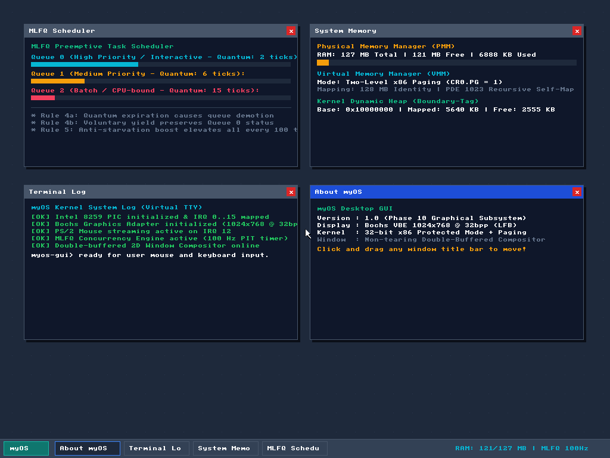

# myOS — 32-Bit x86 Protected Mode Operating System

**myOS** is an educational, modular 32-bit x86 operating system built from the ground up in C and Assembly. It features a complete two-stage bootloader with MBR partition and FAT filesystem support, an ELF32 kernel with C runtime initialization, a modern Hardware Abstraction Layer (HAL), an enterprise-grade memory management stack (Physical Memory Manager, Virtual Memory Manager with Paging, and a Kernel Heap Allocator), a preemptive Multi-Level Feedback Queue (MLFQ) scheduler, an interactive command shell, and a high-resolution 1024x768 @ 32bpp graphical desktop with mouse support.

<p align="center">
  
</p>

---

## Architecture Overview

```
                      ┌────────────────────────────────────────┐
                      │    Kernel Core & Application Space     │
                      └───────────────────┬────────────────────┘
                                          │
                      ┌───────────────────▼────────────────────┐
                      │  MLFQ Preemptive Task Scheduler (HAL)  │
                      │  3-Level Queues, Stack Switching, ISR  │
                      └───────────────────┬────────────────────┘
                                          │
                      ┌───────────────────▼────────────────────┐
                      │    Kernel Heap (kmalloc / kfree)       │
                      │  Boundary-tag allocator, 8-byte align  │
                      └───────────────────┬────────────────────┘
                                          │
                      ┌───────────────────▼────────────────────┐
                      │  Virtual Memory Manager (VMM / Paging) │
                      │  Two-level paging, recursive PDE 1023  │
                      └───────────────────┬────────────────────┘
                                          │
                      ┌───────────────────▼────────────────────┐
                      │  Physical Memory Manager (PMM / Bitmap)│
                      │  Page frame allocator, E820 detection  │
                      └───────────────────┬────────────────────┘
                                          │
 ═════════════════════════════════════════╪═════════════════════════════════════════
                       HARDWARE ABSTRACTION LAYER (HAL)
 ═════════════════════════════════════════╤═════════════════════════════════════════
                                          │
           ┌──────────────────────────────┼──────────────────────────────┐
           ▼                              ▼                              ▼
┌──────────────────────┐      ┌──────────────────────┐      ┌──────────────────────┐
│  CPU & Interrupts    │      │  Graphics & Desktop  │      │  Storage & Boot      │
│  • GDT / IDT / ISR   │      │  • Bochs VBE (32bpp) │      │  • Stage 1 / Stage 2 │
│  • Modular i8259 PIC │      │  • Window Compositor │      │  • MBR Partitions    │
│  • Timer (IRQ 0)     │      │  • 2D Graphics & Font│      │  • FAT12/16/32 Cache │
│  • Keyboard (IRQ 1)  │      │  • VGA Text (0xB8000)│      │  • ELF32 Loader      │
│  • PS/2 Mouse (IRQ12)│      │  • Port 0xE9 Debug   │      │  • ANSI Logger       │
└──────────────────────┘      └──────────────────────┘      └──────────────────────┘
```

---

## Features

### 1. Bootloader (Stage 1 & Stage 2)
- **Stage 1 MBR Boot Sector:** Linked via `linker.ld` producing a symbol map (`boot.map`); preserves the BIOS Parameter Block (BPB); forwards MBR partition entries in `DS:SI`; supports LBA INT 13h extensions; dynamically patched by `install_bootloader.py`.
- **Stage 2 Bootloader:**
  - Real-mode thunk for BIOS `INT 15h AX=0xE820` memory map detection.
  - MBR partition abstraction (`mbr.c`) with automatic fallback for unpartitioned disks.
  - FAT12, FAT16, and FAT32 driver with a **5-sector FAT cache** (`FatCache[2560]`).
  - Full **ELF32 binary loader** (`elf.c`) that validates headers, loads `PT_LOAD` segments, zeroes the `.bss` section, and jumps to `kernel.elf` entry.
  - Packs detected hardware metadata into a unified `BootParams` contract.

### 2. Kernel Hardware Abstraction Layer (HAL)
- **Modular Interrupt System:**
  - Standardized GDT (flat protected mode segments) and IDT (256 gates).
  - Modular `PICDriver` interface with `i8259` implementation and automated IRQ unmasking.
  - Hardware timer tick subscription streaming continuously.
- **Diagnostics & Virtual File System:**
  - Fast Bochs/QEMU Port 0xE9 debug console driver (`e9.c`).
  - Structured ANSI colored logger (`debug.c`) supporting `log_debug`, `log_info`, `log_warn`, `log_err`, `log_crit`.
  - Minimal VFS multiplexer routing standard I/O streams (`stdout`, `stderr`, `debug`).

### 3. Memory Management Subsystem
- **Physical Memory Manager (PMM):**
  - Bitmap-based page frame allocator tracking 4 KiB frames.
  - Bitmap placed dynamically at `PAGE_ALIGN_UP(__end)`.
  - Automatically preserves low memory (`0x00000000`–`0x00100000`), kernel code/data/BSS, and the bitmap itself.
  - High performance: 32-bit chunk scanning using GCC `__builtin_ctz` (x86 `bsf` single-cycle instruction).
  - Supports contiguous multi-page allocation (`PMM_AllocatePages`) and double-free detection.
- **Virtual Memory Manager (VMM):**
  - Two-level x86 paging hierarchy (Page Directory and Page Tables).
  - Identity maps physical RAM (128 MB = 32 Page Tables) with `PAGE_PRESENT | PAGE_WRITE`.
  - **Recursive Page Directory Self-Mapping:** Maps PDE 1023 to the Page Directory's own frame, exposing the Page Directory at `0xFFFFF000` and Page Tables at `0xFFC00000 + (K * 4096)`.
  - Dedicated Page Fault Exception (`#PF` - ISR 14) handler decoding `CR2` and error bits.
  - Dynamic on-demand page table allocation via [`VMM_MapPage`](file:///workspaces/myos/src/kernel/hal/vmm.c).
- **Kernel Heap Allocator:**
  - Virtual address space located at `0x10000000` (256 MB mark).
  - Boundary-tag doubly-linked free list allocator with strict 8-byte payload alignment.
  - Block splitting to eliminate internal fragmentation.
  - Bidirectional $O(1)$ block coalescing on `kfree` to prevent external fragmentation.
  - Automatic demand expansion (`kheap_expand`) requesting physical frames via PMM/VMM.
  - Standard primitives: `kmalloc`, `kzalloc`, `kfree`, `krealloc`.

### 4. Task Scheduling Subsystem (MLFQ)
- **Multi-Level Feedback Queue (MLFQ) Preemptive & Cooperative Scheduler:**
  - 3 priority levels with distinct time quanta:
    - **Queue 0 (High / Interactive):** 2 ticks (~20 ms)
    - **Queue 1 (Medium):** 6 ticks (~60 ms)
    - **Queue 2 (Low / Batch / CPU-bound):** 15 ticks (~150 ms)
  - Driven by the Intel 8253/8254 Programmable Interval Timer (PIT) programmed to 100 Hz.
  - Hardware context switching integrated directly into `isr.asm` (`mov esp, eax`) and `isr.c`.
  - Forged interrupt stack frames allowing new tasks to bootstrap seamlessly into `Task_Trampoline` with interrupts enabled.
  - **Rule 4b (Interactive Favoritism):** Tasks that voluntarily yield (`Task_Yield()` via `int $0x81`) before consuming their quantum retain their high priority.
  - **Rule 4a (Demotion):** Tasks consuming their entire quantum without yielding are demoted down the queue hierarchy.
  - **Rule 5 (Anti-Starvation Boost):** Every 100 ticks (~1 second), all ready tasks across all queues are elevated back to Queue 0.
  - **Deferred Stack Reaper (Suicide Paradox Solved):** Dead tasks calling `Task_Exit()` mark themselves terminated; their stacks and TCBs are reclaimed on subsequent scheduling cycles when the CPU is safely executing on another task's stack.

### 5. Input Subsystem & Interactive Command Shell (Phase 9)
- **PS/2 Keyboard Driver:**
  - Standard PS/2 controller driver (`keyboard.c`, `keyboard.h`) on ports `0x60` (data) and `0x64` (status/command).
  - Handles Scan Code Set 1 with press/release states for Left/Right Shift, Caps Lock, and Ctrl.
  - IRQ 1 handler dynamically registered on the 8259 PIC with automatic interrupt unmasking.
  - 256-byte circular FIFO ring buffer decoupling hardware interrupt rates from software consumption.
  - Non-busy-waiting key reader (`i686_Keyboard_WaitChar`) that voluntarily yields CPU (`Task_Yield()`), preserving the shell in MLFQ Queue 0 for instant interactive responsiveness.
- **VGA Text Driver Upgrades:**
  - Added in-place destructive backspace (`\b`) handling in `vga_text.c` with cursor repositioning and space clearing.
- **Interactive Command Shell:**
  - Autonomous interactive task (`shell.c`, `shell.h`) running in MLFQ Queue 0.
  - Commands:
    - `help`: Lists all available commands.
    - `clear`: Clears VGA screen and resets cursor position.
    - `ps`: Live table of all active tasks, states, MLFQ queue levels, consumed ticks, yield counts, and preemption counts.
    - `mem`: Detailed memory report across Physical (PMM), Virtual (VMM), and Kernel Heap subsystems.
    - `spawn <name> [interactive|compute]`: Dynamically allocates a new worker task and queues it in the MLFQ scheduler.
    - `kill <pid>`: Dynamically terminates a running task and routes it to the deferred stack reaper.
    - `stats`: Live MLFQ scheduler metrics.
    - `echo <text...>`: Echoes arguments to terminal and Port 0xE9.
    - `user <subcmd>`: Ring 3 user mode commands (`hello`, `count`, `test-gp`, `test-pf`, `test-all`).
    - `gui`: Launches high-resolution 1024x768 GUI desktop.
    - `reboot`: Sends 8042 keyboard controller CPU reset pulse to reboot the machine.

### 6. High-Resolution Graphical User Interface (GUI) & Mouse Subsystem (Phase 10)
- **Bochs Graphics Adapter (BGA) & Linear Framebuffer (LFB):**
  - High-resolution video driver (`bga.c`, `bga.h`) programming ports `0x01CE` and `0x01CF`.
  - Configures **1024x768 @ 32bpp** true-color display mode.
  - Automatically queries PCI configuration space (`pci.c`, `pci.h`) on ports `0xCF8`/`0xCFC` to detect Device `0x1234:0x1111` and map its physical BAR0 framebuffer (`0xFD000000`).
  - Maps 3 MiB (768 pages) of video memory dynamically into the virtual address space using `VMM_MapPage`.
- **PS/2 Mouse Controller Driver:**
  - Standard PS/2 mouse driver (`mouse.c`, `mouse.h`) on IRQ 12 with automatic Master PIC cascade (IRQ 2) unmasking.
  - Decodes 3-byte hardware packets, tracks button states (Left, Right, Middle), and tracks `(x, y)` coordinates clamped to screen dimensions.
- **2D Graphics Engine & Font System:**
  - Non-tearing double-buffering architecture allocating backbuffer in the Kernel Heap (`gfx.c`, `gfx.h`).
  - Software rendering primitives: lines (Bresenham's algorithm), rectangles, circles, alpha-blended fills, and screen clipping.
  - Embedded 8x8 ASCII monochrome font table rendering text across windows and system menus.
  - Software mouse cursor arrow sprite with transparent background and black outline.
- **Desktop Window Manager & Compositor:**
  - Autonomous compositor task (`gui.c`, `gui.h`) running concurrently in MLFQ Queue 0.
  - Sleek modern dark slate desktop with a bottom taskbar, "myOS" Start badge, active window tabs, and a live memory/scheduler status tray.
  - Draggable, interactive windows with drop shadows, colored title bars, client clipping, and close buttons:
    - **MLFQ Task Scheduler Monitor:** Live graphical progress meters for Queues 0, 1, and 2.
    - **System Memory Diagnostics:** Visual bar meters for Physical RAM (PMM), Virtual Memory (VMM), and Kernel Dynamic Heap.
    - **Terminal / Virtual TTY Window:** System diagnostic and event log.
    - **About myOS Window:** System specifications and architecture details.

### 7. Ring 3 User Mode, TSS & Syscall Subsystem (Phase 11)
- **Hardware Privilege Separation:**
  - Configured GDT with Ring 3 User Code Segment (`0x18 | 3 = 0x1B`, DPL 3) and User Data Segment (`0x20 | 3 = 0x23`, DPL 3).
  - Implemented 32-bit Task State Segment (`tss.c`, `tss.h`) descriptor (`0x28`) and loaded Task Register (`TR`) via `i686_LTR`.
  - Dynamically updates TSS `esp0` kernel stack pointer during context switches (`TSS_SetKernelStack`) to guarantee isolated kernel stack frames upon Ring 3 -> Ring 0 transitions.
- **System Call Subsystem (`int 0x80`):**
  - Programmed IDT gate `0x80` (128) with `IDT_FLAG_RING3 | IDT_FLAG_GATE_32BIT_INT` (`0xEE`).
  - Implemented centralized register-based syscall dispatcher (`syscall.c`, `syscall.h`):
    - `SYS_EXIT` (0): Clean process termination and exit code reporting.
    - `SYS_PRINT` (1): Console/serial text streaming.
    - `SYS_READ` (2): Standard input keyboard reading.
    - `SYS_YIELD` (3): Cooperative CPU time-slice yielding.
    - `SYS_GETPID` (4): Process ID query.
    - `SYS_SLEEP` (5): Non-busy timer tick sleeping with `wake_tick` scheduling.
    - `SYS_GETTICKS` (6): System uptime timer query.
    - `SYS_SBRK` (7): Dynamic user-space heap allocation.
    - `SYS_BEEP` (8): PC speaker acoustic feedback.
- **User Memory Space & Fault Isolation:**
  - Dedicated user virtual memory window at `0x40000000 + (PID * 0x20000)` (1 GiB boundary).
  - Code and user stack pages mapped with `PAGE_PRESENT | PAGE_WRITE | PAGE_USER`.
  - Strict hardware protection: unauthorized kernel access (< 1 GiB) triggers `#PF` (Page Fault, err `0x5`).
  - Privileged instructions (`cli`, `inb`, `outb`) trigger `#GP` (General Protection Fault, int 13).
  - Fault containment: offending user tasks are cleanly killed via `Task_Exit()` without kernel panics.

### 8. Storage Device Subsystem, FAT Filesystem & VFS (Phase 12)
- **IDE / ATA PIO Controller Driver:**
  - Direct hardware access on Primary ATA Bus (`0x1F0`–`0x1F7`, Control `0x3F6`).
  - 28-bit LBA Programmed I/O supporting `IDENTIFY` (`0xEC`), `READ SECTORS` (`0x20`), `WRITE SECTORS` (`0x30`), and `CACHE FLUSH` (`0xE7`).
  - Status register polling (`BSY`, `DRQ`, `ERR`, `DF`) with 400ns recovery delay.
- **Kernel FAT Filesystem Driver:**
  - Mounts FAT12/FAT16 filesystems directly from disk sector 0 (BPB).
  - High-performance FAT table sector caching with automatic mirror synchronization across both FAT tables.
  - Dynamic cluster allocation, linked-list traversal, path resolution, and file truncation/resizing.
- **Virtual File System (VFS) Layer:**
  - Standard POSIX file descriptor table: `0` (stdin), `1` (stdout), `2` (stderr), `3` (debug), `4`..`19` (disk files).
  - Functions: `vfs_open`, `vfs_read`, `vfs_write`, `vfs_close`, `vfs_readdir`, `vfs_stat`, `vfs_touch`.
- **User Mode VFS Syscalls:**
  - Seamlessly bridges user mode to storage: `SYS_OPEN` (10), `SYS_CLOSE` (11), `SYS_READ_FILE` (12), `SYS_WRITE_FILE` (13), `SYS_READDIR` (14), `SYS_STAT` (15).
- **Desktop File Explorer & Storage Shell Commands:**
  - Interactive Desktop Window displaying directory listings with file icons and sizes.
  - Shell commands: `disk` (hardware inspection), `ls [path]`, `cat <file>`, `touch <file>`, `write <file> <text...>`.

### 9. ELF32 Dynamic Binary Loader, User Runtime & Applications (Phase 13)
- **Dynamic ELF32 Binary Loader (`elf_loader.c`, `elf_loader.h`):**
  - Parses and verifies standard 32-bit ELF binaries compiled with `i686-elf-gcc` (`ET_EXEC`, `EM_386`).
  - Allocates dedicated per-process Page Directories (`pd_phys`) mapping user space at virtual `0x40000000+` while sharing kernel identity mappings.
  - Automatically loads and maps `PT_LOAD` segments, zero-fills `.bss`, and provisions a 16 KiB private user stack (`0x400FC000`–`0x40100000`).
- **System V i386 ABI Call Frame & Process Lifecycle:**
  - `Task_CreateUserFromELF` sets up the initial stack frame with standard `argc`, `argv` string pointers, and NULL-terminated pointer arrays.
  - Forges Ring 3 `IRET` frames (`CS=0x1B`, `SS=0x23`, `EFLAGS=0x0202`) with hardware `CR3` page directory switching in `Task_Schedule`.
  - Process lifecycle management with `Task_WaitPID` and zombie state protection (`waitable`/`reapable`) preventing premature task destruction before exit code collection.
  - New syscalls: `SYS_SPAWN` (16) and `SYS_WAITPID` (17).
- **User-Space Runtime & Standard Library (`src/user/`):**
  - Custom user linker script `linker.ld` (virtual entry at `0x40000000`).
  - Runtime startup stub `crt0.asm` extracting `argc`/`argv` and passing return codes to `sys_exit`.
  - User library `libuser.c`, `libuser.h` providing full syscall wrappers, string routines, and formatted `printf`.
- **Standalone User Applications (`/bin/`):**
  - `hello.elf`: Inspects PID and outputs command-line arguments.
  - `calc.elf`: Interactive command-line arithmetic evaluator (`+`, `-`, `*`, `/`, `%`) returning result as exit status.
  - `counter.elf`: Countdown loop exercising non-busy `sys_sleep()` cycles and returning code 42.
  - `cat.elf`: Standalone file viewer reading disk files directly via `sys_open`/`sys_read_file` syscalls.
- **Interactive Shell Execution:**
  - `exec <filepath> [args...]` command with automatic fallback to `/bin/<cmd>` and `/bin/<cmd>.elf`.

### 10. Standard C Library (`libmyos`), POSIX Subsystem Expansion & User Applications (Phase 14)
- **User Dynamic Heap Allocator:**
  - Boundary-tag memory allocator implemented in user space (`libuser.c`, `libuser.h`).
  - Supports 8-byte payload alignment, block splitting, and bidirectional $O(1)$ coalescing.
  - Automatically requests virtual memory backing from kernel via `sys_sbrk` (`SYS_SBRK` 7).
  - Standard primitives: `malloc`, `free`, `calloc`, `realloc`.
- **POSIX Standard Streams & File I/O:**
  - Full stream abstraction supporting buffered `FILE*`, `stdin` (fd 0), `stdout` (fd 1), `stderr` (fd 2).
  - Stream methods: `fopen`, `fclose`, `fread`, `fwrite`, `fseek`, `ftell`, `fgetc`, `fputc`, `fgets`, `fputs`, `feof`, `ferror`.
  - Formatted I/O: `vsnprintf`, `snprintf`, `sprintf`, `vfprintf`, `fprintf`, `printf`.
  - String & memory routines: `memset`, `memcpy`, `memmove`, `memcmp`, `strlen`, `strcpy`, `strncpy`, `strcmp`, `strncmp`, `strcat`, `strncat`, `strchr`, `strrchr`, `strstr`, `strtok`, `strdup`.
  - Standard utilities: `atoi`, `atol`, `itoa`, `qsort`, `rand`, `srand`, `abs`.
- **Kernel Syscall & VFS Enhancements:**
  - Added `SYS_SEEK` (18) and kernel `sys_lseek` supporting `SEEK_SET`, `SEEK_CUR`, and `SEEK_END`.
  - Dynamic user heap page frame and page table tracking with deferred reaper cleanup upon process termination.
  - Port 0xE9 debug console mirroring for standard user output streams.
- **Expanded Standalone Applications (`/bin/`):**
  - `wc.elf`: POSIX file word, line, and byte counter using `fgetc`.
  - `grep.elf`: Fast substring search across disk files using `fgets` and `strstr`.
  - `snake.elf`: Dynamic game simulation exercising heap allocation and linked lists (`malloc`/`free`).
  - `sh.elf`: Ring 3 user subshell with built-ins (`cd`, `pwd`, `help`, `exit`) and child process batch execution (`-c`) using `sys_spawn` and `sys_waitpid`.

---

## Memory Map Layout

```
0x00000000 ────────┐
                   │  Lower 1 MB: BIOS IVT, BDA, EBDA, VGA Text (0xB8000), Stage 1/2
0x00100000 ────────┼──
                   │  Kernel ELF Executable (.text, .rodata, .data, .bss)
0x00107690 ────────┼──
                   │  PMM Frame Tracking Bitmap (4 KiB)
0x00108000 ────────┼──
                   │  Kernel Page Directory & Identity-Mapped Page Tables
                   │  Usable Physical RAM (Identity-mapped up to 128 MB)
0x08000000 ────────┴──
                   ...
0x10000000 ────────┬── [KERNEL HEAP BASE (256 MB)]
                   │   Initial heap: 1 MiB (256 pages)
                   │   Expands dynamically up to 64 MiB
0x14000000 ────────┴── [KERNEL HEAP CEILING (320 MB)]
                   ...
0x40000000 ────────┬── [USER SPACE BASE (1 GiB)]
                   │   Dedicated 128 KiB slots per user process (Code, Stack, Heap)
                   │   Mapped with PAGE_PRESENT | PAGE_WRITE | PAGE_USER
0x80000000 ────────┴── [USER SPACE CEILING (2 GiB)]
                   ...
0xFFC00000 ────────┬── Recursive Page Tables Window
0xFFFFF000 ────────┴── Recursive Page Directory (Self-Mapped PDE 1023)
```

---

## Project Structure

```
myos/
├── CMakeLists.txt              # Root CMake build file
├── Makefile                    # Make bridge for toolchain and CMake targets
├── OS_PROGRESS_TRACKER.md      # Detailed milestone and architectural tracker
├── build_scripts/
│   ├── install_bootloader.py   # Injects Stage 2 sector metadata into Stage 1 BPB
│   ├── generate_isrs.sh        # Generates assembly exception gates
│   └── setup_toolchain.sh      # Automates i686-elf cross-compiler build
├── cmake/
│   └── toolchain.cmake         # CMake toolchain configuration
├── src/
│   ├── bootloader/
│   │   ├── stage1/             # MBR boot sector (boot.asm, linker.ld)
│   │   └── stage2/             # 32-bit loader (E820, MBR, FAT12/16/32, ELF32)
│   ├── kernel/
│   │   ├── arch/i686/          # x86 CPU hardware drivers (GDT, IDT, PIC, VMM assembly)
│   │   ├── hal/                # Hardware Abstraction Layer (PMM, VMM, Heap, VFS, ELF Loader)
│   │   ├── main.c              # Kernel entry point and test suite
│   │   └── linker.ld           # elf32-i386 kernel linker script
│   ├── user/                   # Ring 3 User-space runtime & applications
│   │   ├── crt0.asm            # User-space C runtime startup
│   │   ├── linker.ld           # User application linker script (0x40000000)
│   │   ├── libuser.h/c         # Standard user library and syscall wrappers
│   │   └── apps/               # Standalone applications (hello, calc, counter, cat, wc, grep, sh, snake)
│   └── libs/
│       └── boot/
│           └── bootparams.h    # Shared Stage 2 <-> Kernel boot data contract
└── tools/
    └── fat/                    # Host FAT manipulation utilities
```

---

## Getting Started

### Prerequisites
- **Linux** or **Docker / Devcontainer** (recommended)
- **i686-elf cross-compiler** (GCC 11.2.0, binutils)
- **CMake** (>= 3.10)
- **NASM** (>= 2.15)
- **QEMU** (`qemu-system-i386`)
- **mtools** (`mkfs.fat`, `mcopy`, `mmd`)

### 1. Build the Toolchain
If you haven't built the cross-compiler yet, run:
```bash
make toolchain
```
This automatically compiles `i686-elf-gcc` and `i686-elf-binutils` into `./toolchain/`.

### 2. Build the Operating System
```bash
make build
```
This configures CMake, compiles the bootloader stages, compiles the kernel ELF with global constructors (`crti.o`/`crtn.o`), creates the bootable disk image, and patches the boot sector.

### 3. Run in QEMU
- **Text / Debug Console mode (Default):**
  ```bash
  make run
  ```
- **High-Resolution Graphical Desktop mode:**
  ```bash
  make run-gui
  ```
  *(Automatically launches a native GUI window if a display server is available, or activates the built-in VNC server on port `5900` / WebSocket `6080` in headless environments).*

Or run directly with Port 0xE9 debug console redirection:
```bash
qemu-system-i386 -drive file=build/main_floppy.img,format=raw,if=ide -debugcon stdio
```

---

## Verification & Progress Tracking
All architectural milestones, design specifications, bug fixes, and verification logs are documented in [`OS_PROGRESS_TRACKER.md`](OS_PROGRESS_TRACKER.md).

---

## License
This project is licensed for educational and developmental purposes.
